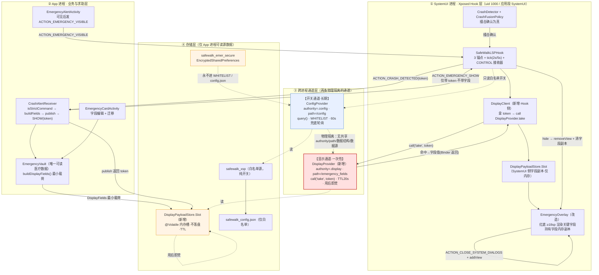
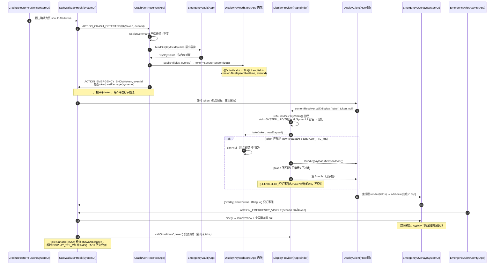
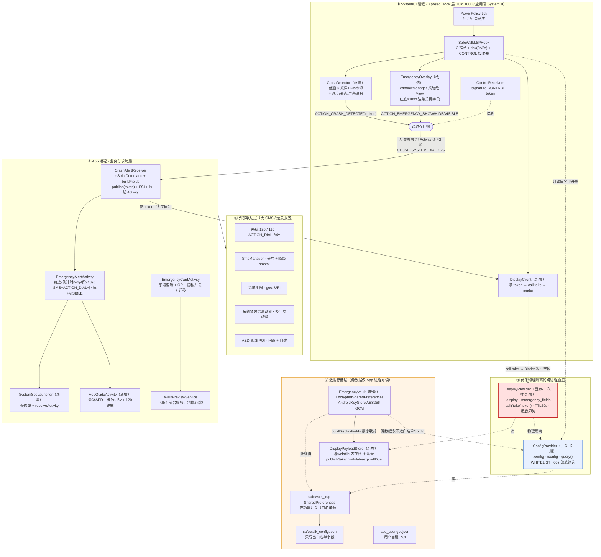
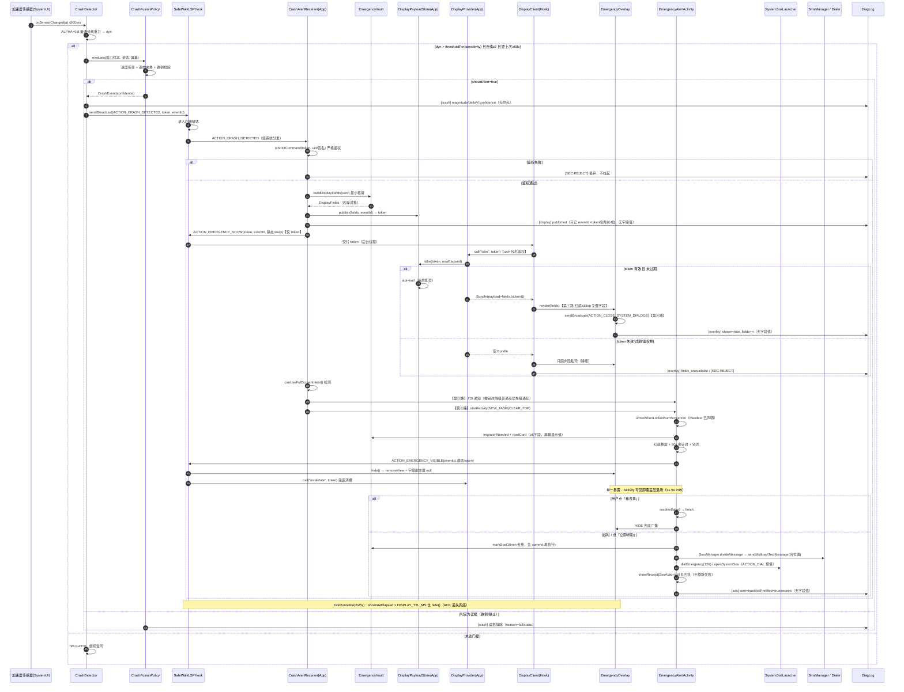

# SafeWalk「医疗急救卡功能」架构设计 · 增量修订 v1.1

> 架构师：高见远（Gao） · 版本：v1.1（arch-emergency，增量修订）
> 基线文档：`docs/emergency-medical-card-ARCH.md` v1.0（arch-emergency）
> 代码基线：`/workspace/io.github.wumisc.safewalk`，versionName **5.4.19** / versionCode **84**（同 v1.0）
> 本文件只写**相对 v1.0 的变更**；未列出的章节（§2.1 选型总表其余行、§2.3 迁移、§2.4 AED、§3 文件列表其余项、§5.2/§5.3 时序、§6 省电、§8 依赖、§10.1 Q1–Q6、§10.3 其余风险、附录）**全部保持不变**。
> 核实方式：已逐行 Read v1.0 与 `ConfigProvider.kt`、`SafeWalkDataStore.kt`、`SafeWalkLSPHook.kt`、`CrashAlertReceiver.java`、`EmergencyAlertActivity.java`、`activity_emergency_alert.xml`、`EmergencyCardActivity.java`、`AndroidManifest.xml`、`CrashDetector.kt`。

---

## 1. 修订摘要

### 1.1 三项裁决的落点

| # | 用户裁决（原文） | v1.0 默认方案 | v1.1 落点 | 变更类型 |
|---|---|---|---|---|
| 1 | 接受"100% = 开机 + SystemUI 存活"的书面边界 | §10.1 Q1 已接受，§1.2 已书面明示不可达边界 | **不变**，按 v1.0 执行 | 保持 |
| 2 | "不可以，关键时候主要信息必须显示，要不然影响救助效率" | §10.2 第 2 条 / §2.1「覆盖层内容」：只画非隐私壳，医疗内容交给 Activity | **推翻**。新增独立 `DisplayProvider` 一次性显示通道，覆盖层**直接渲染关键医疗字段**；书面放宽"医疗字段不跨进程"边界（受控放宽，非取消） | **重大变更（本次重心）** |
| 3 | "做" —— 老用户明文急救卡本期做加密迁移 | §2.3 幂等迁移方案 | **不变**，按 v1.0 §2.3 执行 | 保持 |

### 1.2 逐设计点变更清单

| 设计点 | v1.0 | v1.1 | 影响章节 |
|---|---|---|---|
| 隐私硬边界 | 医疗字段"永不出 App 进程" | **受控放宽**：医疗字段可出进程，但仅限 DisplayProvider 一次性通道 + TTL 窗口 + system uid/SystemUI 包名鉴权 + 载荷最小化 | §1.3、§9、§10.2 |
| 跨进程通道 | 仅 ConfigProvider 一条（白名单开关） | **两条物理隔离通道**：ConfigProvider（开关同步，长期）+ DisplayProvider（显示载荷，一次性短生命周期） | §1.1、§2.2、§4 |
| 覆盖层内容 | 非隐私壳（红底 + 提示 + 按钮），不渲染字段 | 红底高对比**直接渲染关键字段**（≥5 项、≥18sp）+ 按钮 | §2.1「覆盖层内容」行（见 §5 连带替换）、§2.2 |
| 字段传递方式 | 广播不传卡内容，只传事件 ID/confidence/token | 广播仍**只传一次性 display token**；字段本体走 `DisplayProvider.call("take", token)` 的 Binder 返回，**内存态、落去即焚** | §5.1、§9 |
| 令牌 | 单一静态 `BROADCAST_TOKEN` | 静态 token（广播鉴权，**不变**）+ **新增一次性 display token**（SecureRandom，用后即焚） | §9、§4 |
| TTL 机制 | 无显示载荷 TTL；仅 `OVERLAY_RESYNC_MS=60s` 保鲜期 | 新增 `DISPLAY_TTL_MS=20s`（建议 15–30s）：take 时校验 + tick 到期自动 removeView + token 失效 | §2.2、§5.1、§9 |
| 鉴权 | `isTrustedCaller()`（ConfigProvider 实例方法） | 新增 `isTrustedDisplayCaller()`（DisplayProvider 自有实例方法，逻辑同源、独立实现，fail-closed）；**不复用**白名单集合 | §2.2、§9 |
| 协同退场 | Activity 起来后 ACK → removeView（壳退场） | 同机制，但退场时**额外销毁覆盖层内存中的字段副本**；新增 `ACTION_EMERGENCY_VISIBLE` | §5.1、§7 T04 |
| 脱敏规则 | 医疗字段值永不出现在日志/文件/Intent extra | **拆分**：日志/文件**永不写值**（不变）；屏幕（覆盖层 + Activity）按裁决**显示值**（放宽） | §9、§10.2 |
| 测试第 5 组 | 只测 Activity ≥6 字段 / 关键 ≥18sp | 覆盖**两个显示面**：Activity 面（原样）+ 覆盖层面（字段集/字号/红底/一次性/TTL/鉴权） | §7 T03/T04 |
| 任务与依赖 | T01–T05，T04 锁屏四路 | 任务数/依赖**不变**；T01/T02/T03/T04 增工作项；T04 新增 `DisplayProvider.kt`、`DisplayPayloadStore.kt`、`DisplayFields.kt` | §6 全文、§7 T04 |

### 1.3 保持不变的边界（用户裁决 1 / 3 与全部未裁决项）

- 四路触达定义、不可达边界（关机/没电/SystemUI 崩溃/作用域取消不承诺）、撞击瞬间预发 SMS 回执降级 —— 全部不变。
- 加密迁移 §2.3 全流程、`safewalk_xsp` 旧 key 兼容、`emerLastSosTs` 不进白名单 —— 全部不变。
- ConfigProvider.WHITELIST **永不加入任何医疗字段**；`safewalk_config.json` 不含医疗字段 —— 铁律，不变。
- 省电约束：不新增常驻高频轮询、不新增 wake lock、不新增传感器监听器 —— 不变。
- DiagLog / logcat / 崩溃堆栈 / 落盘文件永不写医疗字段值 —— 铁律，不变。
- AED、QR、系统 SOS、依整包依赖、minSdk33/targetSdk35 —— 全部不变。

---

## 2. 新增独立显示通道设计

### 2.1 分层架构：两条物理隔离的跨进程通道



**两条通道的物理隔离对照表**（工程师据此确认没有污染开关同步链路）：

| 维度 | ConfigProvider（开关通道，不变） | DisplayProvider（显示通道，新增） |
|---|---|---|
| authority | `io.github.wumisc.safewalk.config` | `io.github.wumisc.safewalk.display` |
| path | `/config` | `/emergency_fields` |
| 暴露方法 | `query()`（读 JSON 快照）+ `call("clearTestAction")` | **仅 `call("take", token)`**；`query()` 恒返回空 Cursor（杜绝被当配置读） |
| 数据源 | `safewalk_xsp` 白名单字段 | `DisplayPayloadStore` 内存槽（源自 `EmergencyVault`） |
| 生命周期 | 常驻，可被 60s 兜底轮询 | 撞击窗口内瞬时存在，TTL 20s，用后即焚 |
| 数据量 | 全部开关（几十项） | 最小字段集（≤8 项） |
| 鉴权方法 | `isTrustedCaller()` | `isTrustedDisplayCaller()`（独立实现） |
| 是否落盘 | 白名单进 `safewalk_config.json` | **绝不落盘**（内存 only） |
| 令牌 | 静态 `BROADCAST_TOKEN` | 静态 token（广播）+ **一次性 display token**（取件） |

> **关键结论**：两通道不共享 authority、path、方法、数据源、鉴权实例、令牌。ConfigProvider.WHITELIST 与 `safewalk_config.json` 全程不接触显示载荷，功能开关同步链路零污染。

### 2.2 鉴权、一次性令牌与 TTL 时序



**四层安全机制（缺一不可，工程师逐条实现）**：

1. **静态广播令牌（第一道）**：`ACTION_EMERGENCY_SHOW/VISIBLE` 复用 `EXTRA_BROADCAST_TOKEN = "safewalk-bc-2.5"` + `setPackage("com.android.systemui")` + signature 级 `CONTROL` 权限接收器（`ReceiverCompat.registerExportedWithPermission`）。第三方应用无法伪造 SHOW 指令。逻辑与现有 `heartbeatReceiver`/`configChangedReceiver` 完全一致。
2. **一次性 display token（第二道·用后即焚）**：`SecureRandom` 生成 16 字节 → Base64-URL（≥22 字符，128bit 熵），每次撞击事件**全新生成**，不硬编码、不复用。广播**只传 token**；`DisplayPayloadStore.take()` 命中后立刻 `slot=null`，第二次 take 恒返回空（防重放、防重复渲染）。
3. **TTL 时间窗（第三道）**：`DISPLAY_TTL_MS = 20_000L`（建议区间 15–30s，取中值）。双重校验：a) `take()` 用 `SystemClock.elapsedRealtime()` 校验 `now - createdAt ≤ TTL`（不受用户改系统时间影响）；b) Hook tick 里用 `shownAtElapsed` 校验，超时 `hide()` —— **复用既有 `tickRunnable`，不另起定时器、不开 wake lock**。
4. **uid + 包名双重鉴权（第四道·fail-closed）**：`isTrustedDisplayCaller()` 与 `ConfigProvider.isTrustedCaller()` 同源判定（`uid==SYSTEM_UID || myUid` → 放行；系统段 uid 且 callingPackage 为 SystemUI → 放行；**应用段 uid 的 SystemUI**（HyperOS 3/4）按包名列表 `com.android.systemui` / `com.miui.systemui` / `com.android.keyguard` / `com.android.systemui:*` 放行；其余**拒绝**）。**必须独立实现**，不复用 ConfigProvider 的白名单集合或私有方法，避免把显示通道和开关通道耦合。

> **Manifest 关键坑（务必避免）**：`DisplayProvider` **不能**挂 `android:permission="...CONTROL"`。CONTROL 是 signature 级、由 App 自己声明，SystemUI 是系统签名、与 App 不同签名，挂上后 SystemUI 的 `call()` 会被系统拒绝。这与现有 `ConfigProvider` "exported=true 但不挂 permission、靠代码 uid/包名鉴权"的做法一致 —— 照抄该模式。

### 2.3 载荷字段清单（受控放宽后仍最小化）

**覆盖层显示字段（`DisplayFields`，≤8 项，红底 ≥18sp，字号统一 ≥18sp）**：

| 字段 | 显示形态 | 理由 |
|---|---|---|
| 姓名 `name` | `张三` | 施救对象识别，最重要 |
| 血型 `bloodType` + `rh` | `A型 Rh+` | 输血决策关键（用户裁决点名） |
| 过敏 `allergy` + `allergySevere` | `★严重过敏：青霉素`（严重时前置★并加粗） | 用药安全，致命性最高（用户裁决点名） |
| 基础疾病 `conditions` | `基础疾病：心脏病、糖尿病` | 现场处置依据（用户裁决点名） |
| 主联系人 `primaryContactName` + `primaryContactPhone` | `联系人：李四 138****0000`（**仅主联系人 1 个**） | 现场联络（用户裁决点名）；只取 1 个避免暴露全部号码 |
| 年龄 `age`（可选，有值才显示） | `年龄：65` | 救助参考 |

**即便放宽也绝不进覆盖层**（工程师在 `buildDisplayFields()` 里白名单式取字段，不得用反射或全量序列化）：

| 字段 | 不进的理由 |
|---|---|
| 医保号 `insuranceId` | 现场救助无用，属高敏感身份信息，泄露代价大 |
| QR 全量载荷 `qrPayload` | 等于绕过最小化，一次扫码可读全部隐私 |
| 住址 `address` | 现场价值低于联系人，门牌属敏感信息；**Activity 面可保留显示**（详见 §7 待明确 U1） |
| 用药 `medications` / 器官捐献 `organDonation` | 现场非最优先，接口留空 |
| 多联系人列表 / 坐标位置 / 完整备注 | 超出"显示必需"范围 |

**隐私开关与用户裁决的冲突处理**：v1.0 `PrivacyFlags.showBloodOnLock` / `showAddressOnLock` 在"撞击确认为真"的自动覆盖层上**不生效**（用户裁决"主要信息必须显示"优先）；这类开关仅约束"手动预览急救卡"等非撞击场景。需在设置页明示"撞击触发时关键信息将锁屏直接显示"（详见 §7 待明确 U2）。

### 2.4 与 Activity 的协同退场规则（避免双层叠盖与重复暴露）

| 场景 | 时序 | 处理 |
|---|---|---|
| 正常（覆盖层先、Activity 后） | take 成功 → 覆盖层渲染 → Activity 可见 | Activity `onWindowFocusChanged(true)`/`onResume` 发 `ACTION_EMERGENCY_VISIBLE` → Hook `hide()`：removeView + 字段内存副本置 null + 兜底 `call("invalidate", token)` |
| Activity 先可见、覆盖层尚未渲染 | take 尚未发生 | Hook 记 `activityVisible=true`；后续若收到 take 结果，仍可短显一次后立即 hide，或按实现直接丢弃（推荐：记标志，SHOW/take 前先查该标志） |
| ACK 广播丢失 / Activity 进程被杀 | 无 VISIBLE | tick 的 `shownAtElapsed > TTL` 兜底 `hide()`；配合既有 `OVERLAY_RESYNC_MS=60s` 保鲜期 |
| 覆盖层窗口类型降级 | `TYPE_STATUS_BAR_PANEL` 失败 → `TYPE_APPLICATION_OVERLAY` | 降级**不影响字段显示逻辑**，仅层级变化（沿用 v1.0 §2.2） |
| 用户点"我没事"/超时求助 | Activity `resolve()` | 同 v1.0：Activity `finish()` 前发 `ACTION_EMERGENCY_HIDE`；覆盖层按 ACK 机制退场 |

> **单一暴露原则**：关键字段在任一时刻只在一个显示面可见。覆盖层是"解锁前的第一眼"，Activity 是"解锁后的完整卡"，两者交接由 VISIBLE 广播驱动，交接窗口 ≤1.5s（P95）。

---

## 3. 受控放宽后的隐私边界（哪些放宽、哪些仍是铁律）

### 3.1 放宽的边界（仅以下三项，其余一律不动）

1. **医疗字段可跨进程** —— 但**仅限** DisplayProvider 一次性通道，且必须同时满足：撞击确认为真 + TTL 窗口内 + system uid/SystemUI 包名鉴权 + 载荷最小化白名单。
2. **SystemUI 覆盖层可渲染关键字段** —— 但**仅限** §2.3 字段清单，字号 ≥18sp、红底高对比，且 Activity 可见即退场。
3. **屏幕上可出现医疗字段值** —— 覆盖层与 Activity 两个显示面；这不改变"日志/文件永不写值"。

### 3.2 仍是铁律（不受本次放宽影响）

| 铁律 | 现状核实 | v1.1 要求 |
|---|---|---|
| ConfigProvider.WHITELIST 无医疗字段 | 已核实 D12：全为开关/显示参数 | **永不加**；新增单测 `WHITELIST ∩ MEDICAL_KEYS == ∅` |
| `safewalk_config.json` 无医疗字段 | `exportConfig` 只导出白名单 | 不变；显示载荷**不进**该文件 |
| 医疗字段值不进 DiagLog / logcat / 崩溃堆栈 | v1.0 已设计 `EmergencyDiag.redact()` | **不变**；只记字段名/长度/事件名 |
| 医疗字段值不进跨进程 Intent extra | 现有广播只带事件 ID/confidence/token | **不变**；SHOW/VISIBLE 广播只带 token，**字段只走 Binder 返回** |
| 医疗源数据仅 App 进程可读 | `EmergencyVault` 加密存储 | 不变；SystemUI 只能拿到一次性最小载荷，拿不到 Vault |
| 显示载荷不落盘 | 新增 | Slot 仅 `@Volatile` 内存；进程死/TTL 到即消失；不写文件/SP/日志 |
| 载荷最小化白名单 | 新增 | `buildDisplayFields()` 白名单式取字段；`insuranceId`/`qrPayload`/`address` 等不得出现在 `DisplayFields` |
| token 不记值 | 新增 | 日志只记 `token 哈希前4位 + 事件名`，不记完整 token，不记字段值 |

> 边界表述更新为：**"医疗字段的源数据永不跨进程、永不落盘、永不进日志；唯一例外是撞击确认后，经强鉴权的一次性显示通道，把最小字段集短暂送入 SystemUI 内存用于屏幕渲染，TTL 到即焚。"**

---

## 4. 受影响章节精确替换（工程师据此覆盖 v1.0 对应章节）

> 以下每块标注 `【替换 §X】`，为新文本全文，直接覆盖 v1.0 同名章节。未标注的 v1.0 章节不动。

---

### 【替换 §1.1】分层架构

系统按 **4 层 + 2 条跨进程通道** 组织。核心矛盾已从 v1.0 的"SystemUI 要显示、医疗字段不能出进程"变为"用户裁决要求覆盖层直接显示关键字段，但必须守住隐私契约"。解法是**受控放宽**：保留 ConfigProvider 白名单开关通道原样，另建一条**独立、专用、短生命周期、强鉴权**的 DisplayProvider 显示通道 —— 仅在撞击确认为真 + TTL 20s 窗口内，把最小字段集经一次性令牌送入 SystemUI 内存渲染，用后即焚。两通道物理隔离，互不污染。



---

### 【替换 §1.3】隐私硬边界（受控放宽版）

```
【铁律·源数据】
ConfigProvider.WHITELIST ── 可跨进程 ──> 功能开关 / 显示参数（含 enableCrashDetection、crashSensitivity、enableDiagLog）
                                          ✗ 永不含任何医疗字段 / emerLastSosTs / emerVaultMigrated / QR 载荷
safewalk_config.json     ── 只导出白名单 ──> 无医疗字段
EmergencyVault           ── 仅 App 进程可读 ──> 姓名/年龄/血型/Rh/住址/过敏/疾病/用药/联系人/医保/捐献意愿/QR
DiagLog / logcat / 崩溃堆栈 / 落盘文件 ── 只记字段名与长度 ──> 永不记录上述字段的"值"
跨进程 Intent extra      ── 只传事件 ID / confidence / 一次性 token ──> 永不传医疗字段值

【受控放宽·唯一例外】撞击确认为真 + TTL 20s 窗口内：
EmergencyVault(App) ──buildDisplayFields 最小载荷──> DisplayPayloadStore.Slot(仅内存)
   ──publish 返回一次性 token──> ACTION_EMERGENCY_SHOW(仅带 token)
   ──Hook 拿 token──> DisplayProvider.call("take",token)【uid+包名鉴权】
   ──Binder 返回 DisplayFields──> EmergencyOverlay 红底≥18sp 渲染【屏幕可见值】
   ──take 命中即焚 / Activity 可见 hide / tick TTL 到期──> 字段副本消失
放宽仅限：① 字段可跨进程（一次性通道）② 覆盖层可渲染 ③ 屏幕可显示值。
不放宽：源数据出进程、落盘、进日志、进白名单、进 config.json。
```

---

### 【替换 §2.1 中「覆盖层内容」与「覆盖层」两行】（连带替换，勿遗漏）

> v1.0 §2.1 选型总表这两行承载了旧结论，必须一并覆盖，否则与 §1.1/§2.2 冲突。

| 功能点 | 替换后选型 | 为什么（基于真实代码） |
|---|---|---|
| 覆盖层内容 | **直接渲染关键字段**（`DisplayFields`：姓名 / 血型+Rh / 过敏(严重★) / 基础疾病 / 主联系人 / 可选年龄），统一 ≥18sp、红底高对比；不显示医保号/QR/住址/多联系人 | 用户裁决"关键时候主要信息必须显示"；字段经 DisplayProvider 一次性通道送入，不进白名单/log/文件 |
| 显示数据通道 | 新增 `DisplayProvider`（`call("take",token)`）+ `DisplayPayloadStore`（内存槽）+ `DisplayClient`（Hook 侧）；一次性 token、TTL 20s、uid+包名鉴权、用后即焚；广播只传 token | 两条通道物理隔离，ConfigProvider 白名单链路零污染；省电：不新增轮询/wake lock，TTL 挂既有 tick |

---

### 【替换 §2.2】锁屏覆盖层的真实 SystemUI 锚点 + 显示数据通道落点

现有 Hook 已在 `handleLoadPackage()` 中挂好锚点（D11 正面事实），新覆盖层**不新增 Hook 锚点**，只在 `runInit()` 中加一步：

```kotlin
// SafeWalkLSPHook.runInit() 内，紧跟 step("车祸检测") 之后
step("急救覆盖层") { EmergencyOverlay.install(ctx!!) }
step("显示取件客户端") { DisplayClient.install(ctx!!) }   // v1.1 新增：注册 SHOW/VISIBLE 接收器 + 取件入口
```

`EmergencyOverlay.install()` 的内部落点（窗口部分沿用 v1.0，显示数据部分为 v1.1 新增）：

| 步骤 | 实现要点 | 失败降级 |
|---|---|---|
| 1. 拿 Context | 复用 `runInit` 传入的 `appCtx.applicationContext` | 无 → 覆盖层不可用，仍保留 ②③ |
| 2. 拿 WindowManager | `ctx.getSystemService(WINDOW_SERVICE) as WindowManager`（system uid） | 异常 → `[overlay] wm 不可用`，不阻塞 init |
| 3. 预创建 View 但不 addView | 收到 SHOW 且 `take` 拿到字段才 `addView` | — |
| 4. 窗口类型 | 首选 `TYPE_STATUS_BAR_PANEL`；`BadTokenException`/`SecurityException` → 降级 `TYPE_APPLICATION_OVERLAY`（`FLAG_SHOW_WHEN_LOCKED\|FLAG_TURN_SCREEN_ON\|FLAG_KEEP_SCREEN_ON\|FLAG_LAYOUT_IN_SCREEN`） | 两级都失败 → `[overlay] addView 失败`，靠 ②③ |
| 5. 关闭遮挡对话框 | addView 前 system uid 发 `ACTION_CLOSE_SYSTEM_DIALOGS`（App 侧发无效，必须 Hook 发） | 靠覆盖层层级本身 |
| 6. **【v1.1 新增】取件与渲染** | `DisplayClient.onShow(token)` → 后台线程 `contentResolver.call(.display,"take",token,null)` → 解析 Bundle → 主线程 `overlay.render(fields)`：红底、`DisplayFields` 每项 ≥18sp、严重过敏前置★ | take 返回空（token 失效/过期/鉴权拒）→ 只画非隐私壳（回落 v1.0 行为）+ `[overlay] fields_unavailable` |
| 7. **【v1.1 新增】字段副本与退场** | `overlay` 仅持 `DisplayFields` 内存副本；VISIBLE/TTL/ACK 任一触发 `hide()`：removeView + 副本置 null；`call("invalidate",token)` 兜底清槽 | 残留 → tick 的 `shownAtElapsed > TTL` 与既有 `OVERLAY_RESYNC_MS=60s` 双兜底 |

**DisplayProvider 落点（App 进程新增 ContentProvider）**：

| 项 | 值 |
|---|---|
| 类 | `io.github.wumisc.safewalk.DisplayProvider : ContentProvider` |
| Manifest | `<provider android:name=".DisplayProvider" android:authorities="io.github.wumisc.safewalk.display" android:exported="true" android:enabled="true" />`（**不挂 android:permission**，原因见 §2.2 第 4 道坑） |
| 方法 | `override fun call(method, arg, extras): Bundle?` —— 仅 `method=="take"` 处理；`query()` 恒返回 `MatrixCursor(arrayOf("json"))` 空 Cursor |
| 鉴权 | `private fun isTrustedDisplayCaller(): Boolean`（独立实现，fail-closed，逻辑同 `ConfigProvider.isTrustedCaller()`） |
| 取件 | `DisplayPayloadStore.take(token, SystemClock.elapsedRealtime())` → 命中返回 `Bundle().apply{ putString("payload", fields.toJson()) }`，否则空 Bundle |
| 常量 | 见 §7「新增常量」 |

> **为什么不 hook `KeyguardViewMediator` / `NotificationShadeWindowController`**：同 v1.0 —— 各 ROM 改包名/签名频繁，复用已验证的 Application onCreate 锚点 + system uid WindowManager 稳一个数量级；"盖住即可"足够。字段显示通过独立 ContentProvider 取件，与挂载点无关。

---

### 【替换 §4】数据结构与接口（Mermaid classDiagram）

> 完整替换 v1.0 §4。新增/改动类已标注 `v1.1`，其余沿用 v1.0 定义。

```mermaid
classDiagram
    %% ===== 数据模型 =====
    class EmergencyCard {
        +String id
        +String name
        +Int age
        +Gender gender
        +BloodType bloodType
        +RhFactor rh
        +String address
        +String allergy
        +Boolean allergySevere
        +String conditions
        +String medications
        +List~EmergencyContact~ contacts
        +String insuranceId
        +Boolean organDonation
        +PrivacyFlags privacy
        +Long updatedAt
        +String qrPayload() String
        +static fromJson(String) EmergencyCard
        +String toJson() String
    }
    class DisplayFields {
        <<v1.1 新增·最小显示载荷>>
        +String name
        +String bloodType
        +String rh
        +String allergy
        +Boolean allergySevere
        +String conditions
        +String primaryContactName
        +String primaryContactPhone
        +Int age
        +static fromCard(EmergencyCard) DisplayFields
        +String toJson() String
        +static fromJson(String) DisplayFields
    }
    class EmergencyContact {
        +String name
        +String phone
        +String relation
        +Boolean primary
    }
    class BloodType { <<enumeration>> A B AB O OTHER UNKNOWN }
    class RhFactor { <<enumeration>> POSITIVE NEGATIVE UNKNOWN }
    class PrivacyFlags {
        +Boolean showBloodOnLock
        +Boolean showAddressOnLock
        +Boolean allowSmsLocation
        +Boolean allowQr
    }
    class CrashEvent {
        +Long timestampMs
        +Float magnitude
        +Float deltaV
        +Float poseAngle
        +Boolean screenOff
        +Boolean fallExcluded
        +Float confidence
        +Int sensitivity
        +Boolean shouldAlert() Boolean
    }
    class SosAction {
        +Long eventId
        +SosType type
        +String targetPhone
        +Boolean smsSent
        +Boolean dialPrefilled
        +Boolean systemSosOpened
        +String receipt
        +Long executedAt
    }
    class AedPoi {
        +String id
        +String name
        +Double lat
        +Double lng
        +String address
        +String access
        +String openingHours
        +String phone
        +String source
        +Long verifiedAt
        +Double distanceTo(Double,Double) Double
    }

    %% ===== 存储 / 服务 =====
    class EmergencyVault {
        -SharedPreferences enc
        +init(Context) void
        +migrateIfNeeded(Context) Boolean
        +readCard() EmergencyCard
        +saveCard(EmergencyCard) Boolean
        +buildDisplayFields() DisplayFields
        +lastSosTs() Long
        +markSos(SosAction) void
        +clear() void
    }
    class DisplayPayloadStore {
        <<v1.1 新增·仅内存·不落盘>>
        -Slot slot
        +DISPLAY_TTL_MS : Long = 20000
        +publish(DisplayFields,String) String
        +take(String,Long) DisplayFields
        +invalidate(String) void
        +expireIfDue(Long) Boolean
        +clear() void
    }
    class DisplaySlot {
        <<v1.1 新增>>
        +String token
        +DisplayFields fields
        +Long createdAtElapsed
        +String eventId
    }
    class EmergencyDiag {
        +redact(String,String) String
        +logCard(String,EmergencyCard) void
        +event(String,String) void
    }
    class ConfigProvider {
        +Set~String~ WHITELIST
        +isTrustedCaller() Boolean
        +query(...) Cursor
    }
    class DisplayProvider {
        <<v1.1 新增·App 进程 Binder 端点>>
        -isTrustedDisplayCaller() Boolean
        +call(method,arg,extras) Bundle
        +query(...) Cursor
    }
    class SafeWalkConfig { +exportConfig(Context) void +loadConfig(Context) JSONObject }

    %% ===== SystemUI Hook 层 =====
    class SafeWalkLSPHook {
        -CrashDetector crashDetector
        -EmergencyOverlay overlay
        -DisplayClient displayClient
        -JSONObject configJson
        +handleLoadPackage(lp) void
        +runInit(ctx) void
        +updateCrashDetection() void
        +tickRunnable() Runnable
    }
    class CrashDetector {
        -Float ALPHA
        -Int HIT_COUNT_REQUIRED
        -Long TRIGGER_COOLDOWN_MS
        +thresholdFor(Int) Float
        +onSensorChanged(e) void
        -onCrashDetected(e) void
    }
    class CrashFusionPolicy { +evaluate(samples,pose,screen) CrashEvent +excludeFall(...) Boolean +deltaV(samples) Float }
    class EmergencyOverlay {
        -WindowManager wm
        -View root
        -DisplayFields fieldsCopy
        -Long shownAtElapsed
        +install(Context) void
        +show(CrashEvent) Boolean
        +render(DisplayFields) void
        +hide() void
        +closeSystemDialogs() void
    }
    class DisplayClient {
        <<v1.1 新增·Hook 侧>>
        +install(Context) void
        -onShow(token,eventId) void
        -takeViaBinder(String) DisplayFields
        -onVisible(eventId) void
    }

    %% ===== App 进程层 =====
    class CrashAlertReceiver { +onReceive(c,i) void -showFullScreenNotification(c) void -publishDisplayFields(i) String }
    class EmergencyAlertActivity {
        -EmergencyCard card
        -Int remain
        +loadCard() void
        +startCountdown() void
        +resolve(Boolean sos) void
        -notifyVisible() void
        -showReceipt(SosAction) void
    }
    class EmergencyCardActivity { -EmergencyCard draft +saveCard() void +copyCard() void +openSosSettings() void }
    class SystemSosLauncher { +openSystemSos(Context) Boolean +dialEmergency(Context,String) Boolean -resolveFirst(Intent) Boolean }
    class AedRepository { +load(Context) List~AedPoi~ +nearestWithin(Double,Double,Int) AedPoi +importGeoJSON(Context,String) Int +exportGeoJSON(Context) String }
    class AedGuideActivity { -AedPoi target +render() void +openInMap() void +dial120() void }
    class ReceiverCompat { +isStrictCommand(r,t,expected) Boolean +senderIsTrusted(r) Boolean +registerExportedWithPermission(...) void }

    %% ===== 关系 =====
    EmergencyCard "1" *-- "0..*" EmergencyContact
    EmergencyCard --> BloodType
    EmergencyCard --> RhFactor
    EmergencyCard --> PrivacyFlags
    DisplayFields ..> EmergencyCard : fromCard 白名单取字段
    EmergencyVault ..> EmergencyCard : 读写
    EmergencyVault ..> DisplayFields : buildDisplayFields
    EmergencyVault ..> CrashEvent : 记录去重
    EmergencyDiag ..> EmergencyCard : 脱敏输出
    EmergencyDiag --> DiagLog

    DisplayPayloadStore "1" *-- "0..1" DisplaySlot
    DisplayPayloadStore ..> DisplayFields
    DisplayProvider ..> DisplayPayloadStore : take/invalidate（App 进程内）
    ConfigProvider ..> SafeWalkConfig : 同源配置
    DisplayProvider -.-x ConfigProvider : 物理隔离·无共享

    SafeWalkLSPHook "1" *-- "1" CrashDetector
    SafeWalkLSPHook "1" *-- "1" EmergencyOverlay
    SafeWalkLSPHook "1" *-- "1" DisplayClient
    CrashDetector ..> CrashFusionPolicy : 二级判定
    CrashFusionPolicy ..> CrashEvent : 产出
    SafeWalkLSPHook ..> ConfigProvider : 只读取白名单开关
    DisplayClient ..> DisplayProvider : call take（跨进程·鉴权）
    DisplayClient ..> EmergencyOverlay : render/hide

    CrashAlertReceiver ..> ReceiverCompat : 严格鉴权
    CrashAlertReceiver ..> EmergencyVault : buildDisplayFields
    CrashAlertReceiver ..> DisplayPayloadStore : publish → token
    CrashAlertReceiver ..> EmergencyAlertActivity : 拉起
    EmergencyAlertActivity ..> EmergencyVault : 读卡/去重
    EmergencyAlertActivity ..> SystemSosLauncher : 联动
    EmergencyAlertActivity ..> AedGuideActivity : 附近AED
    EmergencyAlertActivity ..> SosAction : 产出
    EmergencyCardActivity ..> EmergencyVault : 保存/迁移
    AedGuideActivity ..> AedRepository
    AedRepository "1" *-- "0..*" AedPoi
```



---

### 【替换 §5.1】时序①：碰撞检测 → 锁屏四路强提醒（含一次性显示通道）→ 求助闭环



---

### 【替换 §7 中 T04 任务】锁屏四路强提醒与求助闭环（含一次性显示通道）

- **目标**：把"两路"变"四路"，把"4 字段/15sp"变"≥6 字段/≥18sp"，覆盖层**直接显示关键字段**（红底 ≥18sp），把静默失败变可见回执。
- **要点**：
  1. `EmergencyOverlay.install()` 挂到 `SafeWalkLSPHook.runInit()` 的 `step("急救覆盖层")`；`DisplayClient.install()` 挂 `step("显示取件客户端")`。
  2. 第④路 `ACTION_CLOSE_SYSTEM_DIALOGS` 由 **Hook（system uid）** 发出；App 侧发无效。
  3. `CrashAlertReceiver` 严格鉴权 → `buildDisplayFields()` → `publish()` 生成一次性 token → 发 `ACTION_EMERGENCY_SHOW`（**只带 token**）→ FSI 检测 → 拉起 Activity。
  4. `DisplayProvider.call("take",token)` 是显示载荷**唯一**跨进程出口：独立 `isTrustedDisplayCaller()` 鉴权 + `DisplayPayloadStore.take()`（token 校验 + TTL + 用后即焚）；`query()` 恒空；**不挂** `android:permission`。
  5. `DisplayClient` 后台线程取件、主线程 `overlay.render(fields)`；字段副本仅内存，hide 时置 null。
  6. 协同退场：Activity 可见发 `ACTION_EMERGENCY_VISIBLE` → `hide()` + `call("invalidate",token)`；ACK 丢失由 tick 的 `shownAtElapsed > TTL` 兜底。
  7. `EmergencyAlertActivity` 从 Vault 读卡（屏幕显示值）；新增系统 SOS / 附近 AED / 医疗 QR 按钮；`showReceipt()` 明示结果；起可见广播。
  8. FSI 被撤销时降级：普通高优先级通知 + DiagLog `[sos][fallback]`，不静默。
- **新增文件（本任务）**：`DisplayFields.kt`、`DisplayPayloadStore.kt`、`DisplayProvider.kt`、`DisplayClient.kt`（Hook 侧；可并入 `SafeWalkLSPHook.kt` 同包）。
- **新增常量（写入 `SafeWalkDataStore.kt`，均不进 WHITELIST）**：
  ```kotlin
  const val DISPLAY_AUTHORITY = "io.github.wumisc.safewalk.display"
  const val DISPLAY_PATH = "/emergency_fields"
  const val EXTRA_DISPLAY_TOKEN = "display_token"
  const val ACTION_EMERGENCY_SHOW = "io.github.wumisc.safewalk.EMERGENCY_SHOW"
  const val ACTION_EMERGENCY_VISIBLE = "io.github.wumisc.safewalk.EMERGENCY_VISIBLE"
  const val DISPLAY_TTL_MS = 20_000L   // 建议 15–30s
  ```
- **验收点**：
  - 6 类锁屏状态矩阵（锁屏亮屏/熄屏/勿扰/静音/App 前台/App 后台）逐项真机或 Robolectric 断言：**覆盖层关键字段 ≥5 项可见、关键字段 ≥18sp、红底**；Activity ≥6 字段、关键 ≥18sp。P95 ≤1.5s（DiagLog `[crash]→[overlay] shown`）。
  - 一次性令牌：同一 token 连续 `take` 两次，第二次返回空 Bundle；`invalidate` 后返回空。
  - TTL：`createdAt` 人为回拨 > 20s，`take` 返回空；tick 到期自动 `hide()`（removeView 可断言）。
  - 鉴权：模拟非 system/非 SystemUI uid 调用 `call("take")` → 返回空 + `[SEC:REJECT]`；`query()` 恒空 Cursor。
  - 脱敏两分：字段值**不得**出现在 logcat/DiagLog 落盘/`safewalk_config.json`/广播 extra；**必须**出现在 `DisplayFields` 返回值与两个显示面 TextView。
  - 协同退场：发 `ACTION_EMERGENCY_VISIBLE` 后覆盖层 View 被 removeView（Robolectric `ShadowWindowManager` 或真机截图核验）；无双层叠盖。
  - 降级：token 失效/TTL 过期时只画非隐私壳，不崩、不阻塞 SystemUI 主线程（取件在后台线程）。

---

### 【替换 §9】共享知识 / 跨文件约定（工程师必读）

1. **令牌与签名权限**：跨进程广播必须带 `EXTRA_BROADCAST_TOKEN`（`safewalk-bc-2.5`）；Hook 接收器用 `ReceiverCompat.registerExportedWithPermission(..., CONTROL_PERMISSION)`（signature）。`ACTION_CRASH_DETECTED` 在 App 侧走 `isStrictCommand`。令牌硬编码是已知残留风险（D2），勿外部分发。
2. **两条通道铁律（v1.1 更新）**：① `ConfigProvider.WHITELIST` 只放功能开关/显示参数，**任何医疗字段（含 emerLastSosTs、emerVaultMigrated、QR 载荷、AED 备注）永不加入**，`exportConfig` 白名单过滤不可绕过；② 医疗字段的唯一跨进程出口是 `DisplayProvider.call("take",token)`，一次性 + TTL + uid/包名鉴权 + 载荷最小化；两通道不共享 authority/path/方法/数据源/鉴权。
3. **一次性令牌与 TTL（新增）**：display token 由 `SecureRandom(16B)` 每次事件新生成，Base64-URL，`take` 命中即焚；`DISPLAY_TTL_MS=20s`；`createdAt`/`shownAt` 一律用 `SystemClock.elapsedRealtime()`（不受改系统时间影响，短窗口跨进程可比）；tick 复用既有 2s/5s，不另起定时器、不开 wake lock。
4. **DiagLog 事件命名**：沿用 `[crash]` `[sos]` `[overlay]` `[display]`（新增）`[vault]` `[emergency]` `[aed]` `[SEC:REJECT]` `[SEC:COMPAT]` `[hook]` `[keep]`；新增事件带前缀；高频点用 `logThrottled`。
5. **脱敏规则（v1.1 拆分，勿混淆）**：**永不写值** —— `Log.i`、DiagLog 文件、崩溃堆栈、跨进程 Intent extra、`safewalk_config.json`、DisplayProvider 日志；只允许 `字段名=***(len=N)` / token 哈希前 4 位 / 布尔标志。**允许显示值**（放宽）—— 仅屏幕：`EmergencyOverlay` 与 `EmergencyAlertActivity` 的 TextView；AED 坐标仍不写日志（可写 found/distance）。
6. **进程边界（v1.1 更新）**：`EmergencyVault` 源数据只在 App 进程；SystemUI 只读 ConfigProvider 白名单 + 一次性 DisplayFields；**广播只传 token，字段只走 Binder 返回且仅内存、不落盘**；字段副本在 hide/take/TTL 后消失。
7. **时间与去重**：跨进程 wall clock 用 `System.currentTimeMillis()`；看门狗/冷却/TTL 用 `SystemClock.elapsedRealtime()`；撞击冷却 60s；求助去重 10min（先 `commit()` 再执行）。
8. **Activity 单实例与协同**：`EmergencyAlertActivity` 保持 `singleTask` + `showWhenLocked`/`turnScreenOn`（勿改）；可见后发 `ACTION_EMERGENCY_VISIBLE`，覆盖层退场，保证关键字段单一暴露面。
9. **初始化幂等**：Hook `runInit` 已有 `initLock`/`step()` 兜底；`step("急救覆盖层")`/`step("显示取件客户端")` 各自 `try/catch`，失败不影响心跳。
10. **Kotlin/Java 混编**：纯逻辑用 Kotlin object + `@JvmStatic`（对齐 `PowerPolicy`）；Java Activity 改动保持 Java，经 `@JvmStatic` 调 Kotlin 单例。
11. **UI 体系**：沿用 View/XML；覆盖层字段 TextView 统一 `textSize>=18sp`、`textColor=#FFFFFF`、红底 `#C8392E`/`@color/seal_red`，严重过敏★加粗。

---

### 【替换 §10.2】读码后发现的 PRD 与真实代码差异（裁决后新版）

> §0 的 12 条差异事实不变。此处按"用户裁决结果"重新归类。

**用户已裁决（3 条，本期执行）**：

1. **D6 加密 vs 迁移成本** —— 裁决："做"。按 §2.3 幂等迁移方案执行（工程师可直接落地），无需再决策。
2. **D4 覆盖层与隐私的取舍** —— 裁决："不可以，关键时候主要信息必须显示，要不然影响救助效率"。**v1.0 默认方案（非隐私壳）被否决**。本期落地"受控放宽"：新增独立 `DisplayProvider` 一次性显示通道（TTL + 一次性令牌 + system uid/包名双重鉴权 + 载荷最小化），覆盖层直接渲染关键医疗字段；书面放宽"医疗字段不跨进程"边界，但**保持** ConfigProvider 白名单铁律与日志/文件脱敏铁律。详见 §1.1/§1.3/§2。
3. **D1 测试补强范围** —— v1.0 建议"排期紧张至少做 1/2/3 组"仍为架构底线；本期因显示通道放宽，**T03 第 5 组扩展为覆盖两个显示面 + 一次性令牌/TTL/鉴权**（见 §7），不建议再缩减。

**可直接按架构结论执行、无需决策的 9 条**：D2、D3、D5、D7、D8、D9、D10、D11、D12（同 v1.0，其中 D12 白名单健康是本次放宽仍坚守的前提）。

**本次放宽新增的待明确事项**：见 §7 末尾 U1–U6。

---

## 5. 对 T01–T05 任务列表的影响

### 5.1 任务表（更新后）

| 任务 | 名称 | 依赖 | 优先级 | 相对 v1.0 的变更 |
|---|---|---|---|---|
| **T01** | 基础设施与隐私契约 | — | P0 | **增**：DisplayProvider authority/path/action/TTL 常量（均不进 WHITELIST）；Manifest 声明 `.DisplayProvider`（exported=true、**不挂 permission**）+ SHOW/VISIBLE action；新增"两通道隔离"断言（`WHITELIST ∩ MEDICAL_KEYS == ∅` 且 `DISPLAY_AUTHORITY != CONFIG AUTHORITY`） |
| **T02** | 急救卡数据层与编辑页 | T01 | P0 | **增**：`EmergencyVault.buildDisplayFields()`（白名单式最小载荷，排除 insuranceId/qrPayload/address/多联系人）；设置页明示文案"撞击触发时关键信息锁屏直接显示" |
| **T03** | 碰撞检测融合与鉴权测试强化 | T01 | P0 | **增**：第 5 组扩展为双显示面；新增一次性令牌/TTL/uid 鉴权/`query()` 恒空 4 类测试；脱敏两分断言 |
| **T04** | 锁屏四路强提醒与求助闭环 | T01,T02,T03 | P0 | **增**：4 个新文件（`DisplayFields`/`DisplayPayloadStore`/`DisplayProvider`/`DisplayClient`）；`CrashAlertReceiver` 增 `publishDisplayFields`；`EmergencyAlertActivity` 增 `notifyVisible`；`SafeWalkLSPHook` 增取件/退场/tick TTL；`EmergencyOverlay` 增字段渲染；验收口径按 §7 T04 |
| **T05** | AED 导航与端到端联调 | T04 | P1 | **不变** |

### 5.2 依赖关系与新增文件

- **依赖关系不变**：T01 → T02/T03（可并行）→ T04 → T05。DisplayProvider 相关文件全归 T04，不新增任务、不新增依赖边。
- **新增文件（4 个，全在 T04）**：
  - `app/src/main/java/io/github/wumisc/safewalk/DisplayFields.kt`
  - `app/src/main/java/io/github/wumisc/safewalk/DisplayPayloadStore.kt`
  - `app/src/main/java/io/github/wumisc/safewalk/DisplayProvider.kt`
  - `app/src/main/java/io/github/wumisc/safewalk/DisplayClient.kt`（Hook 侧；亦可并入 `SafeWalkLSPHook.kt`）
- **修改文件（相对 v1.0 文件列表的新增改动）**：`SafeWalkDataStore.kt`（常量）、`AndroidManifest.xml`（provider + action）、`EmergencyVault.kt`（buildDisplayFields）、`CrashAlertReceiver.java`、`EmergencyAlertActivity.java`、`SafeWalkLSPHook.kt`、`EmergencyOverlay.kt`（渲染）、`EmergencyCommandSecurityTest.java`（双显示面 + 令牌/TTL/鉴权）。

### 5.3 验收口径调整汇总

| 验收项 | v1.0 | v1.1 |
|---|---|---|
| 锁屏字段（T03 第 5 组） | Activity ≥6 字段、关键 ≥18sp | **两个显示面**：Activity ≥6 / 关键 ≥18sp；覆盖层 ≥5 关键字段 / ≥18sp / 红底 |
| 覆盖层内容检视 | "不显示任何医疗字段" | **反转为**："关键字段可见且 ≥18sp；非清单字段（医保号/QR/住址）不可见" |
| 脱敏测试 | 字段值不进日志/文件 | **两分**：不进日志/文件/广播 extra/config（不变）；**进** DisplayFields 返回 + 两个显示面 TextView（放宽） |
| 新增 | — | 一次性令牌（二次 take 空）、TTL 到期（take 空 + tick hide）、uid 鉴权（拒绝 + SEC:REJECT）、query 恒空、协同退场（removeView） |

---

## 6. 新增待明确事项（读码后因本次放宽带来的新风险）

| 编号 | 事项 | 架构侧建议 | 需谁确认 |
|---|---|---|---|
| **U1** | **住址是否进覆盖层**：v1.0 Activity 显示住址，用户裁决列举的"主要信息"未含住址 | 建议**不进覆盖层**（现场价值低、门牌敏感），Activity 面保留；若产品坚持，加入 `DisplayFields.address` 并同步更新白名单/测试 | 产品 |
| **U2** | **隐私开关与强制显示冲突**：`showBloodOnLock`/`showAddressOnLock` 在撞击覆盖层上是否仍生效 | 建议撞击确认为真时**忽略**隐私开关（裁决"主要信息必须显示"优先），开关仅约束手动预览；设置页明示代价 | 产品/合规 |
| **U3** | **旁人可见风险**：锁屏覆盖层直接显示姓名/血型/疾病，任何拿到手机的人可见（无需解锁） | 这是裁决明确接受的代价；建议 TTL 尽量短（20s）+ Activity 可见即退场；在设置页/README 明示 | 产品（知情确认） |
| **U4** | **SHOW 广播被 ROM 拦截**：若 `ACTION_EMERGENCY_SHOW` 丢失，覆盖层拿不到 token → 只画壳，医疗字段不显示 | 加 tick 保鲜期重发 SHOW（携带同一 token，仍一次性）；或依赖 FSI/Activity 兜底显示（Activity 面不受影响）；与 `OVERLAY_RESYNC_MS` 同机制 | 工程实现确认 |
| **U5** | **App 进程被拉起失败**：`CrashAlertReceiver` 是 Manifest 组件，系统可拉起；极端被杀时 DisplayFields 无法生成 | 降级：覆盖层无字段 + 撞击瞬间预发 SMS 回执（不可达边界不变）；Activity 面同样依赖进程，属既有边界 | 工程实现确认 |
| **U6** | **多用户/工作资料场景**：DisplayProvider 装在机主，工作资料内 SystemUI 取件的 uid/包名判定 | 复用 `ConfigProvider.isTrustedCaller()` 已验证的 uid/包名兼容逻辑（D12），不新写 uid 白名单；跨用户 Binder 取件需真机验证 | 工程实现确认 |
| **U7** | **token 被监听**：第三方静态注册监听公开 action 可读到 token | 兜底已足：DisplayProvider 侧 uid/包名鉴权拒第三方；token 128bit 随机且一次性；日志只记哈希前 4 位。建议 action 名不对外文档化 | 架构（已给结论） |

---

## 7. 交付口径对照（v1.1 更新）

| PRD / 裁决口径 | v1.1 落实情况 |
|---|---|
| 裁决 1：接受"开机+SystemUI 存活"边界 | ✅ §1.2 不可达边界不变，SMS 回执降级不变 |
| 裁决 2：覆盖层直接显示关键字段 | ✅ 新增 DisplayProvider 一次性通道，覆盖层红底 ≥18sp 渲染关键字段，受控放宽 |
| 裁决 3：本期做加密迁移 | ✅ §2.3 幂等迁移不变 |
| 不破坏隐私契约（更新为"受控放宽"） | ✅ 白名单无医疗字段、config 无医疗字段、日志/文件无值；仅屏幕可见值，一次性 + TTL + 强鉴权 |
| 不污染开关同步链路 | ✅ 两条通道物理隔离（authority/path/方法/数据源/鉴权全不同） |
| 省电约束不变 | ✅ 不新增轮询/wake lock，TTL 挂既有 tick |
| 不承诺绝对 100% | ✅ 四路 + 显式降级边界 + DiagLog 证据链 |
