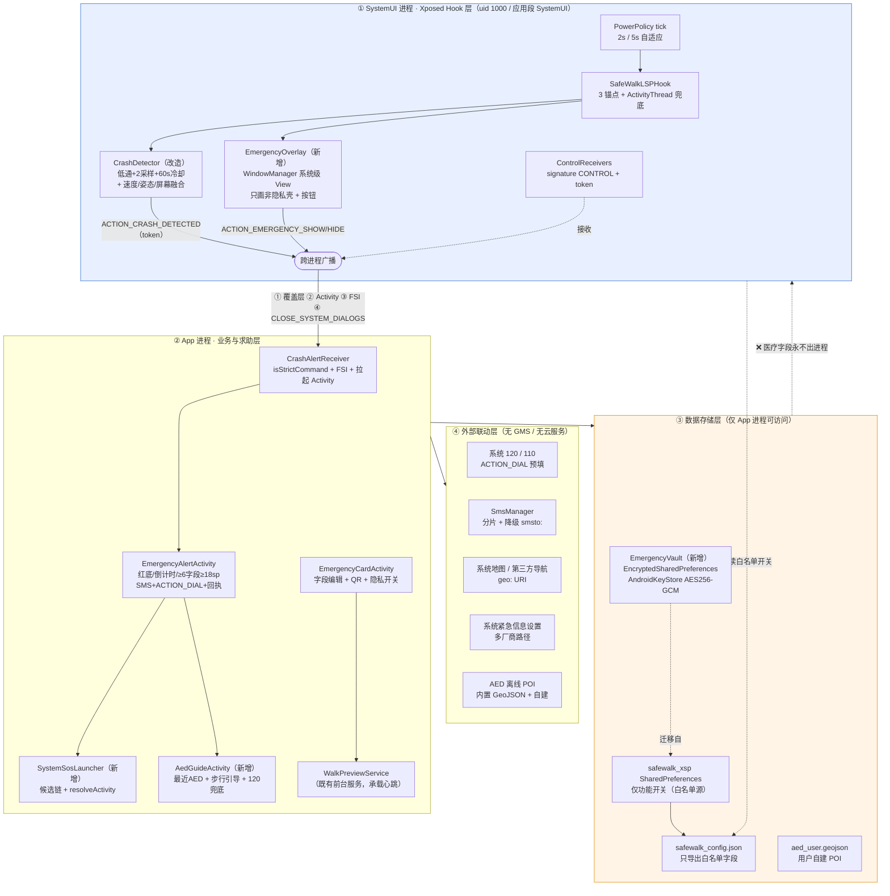
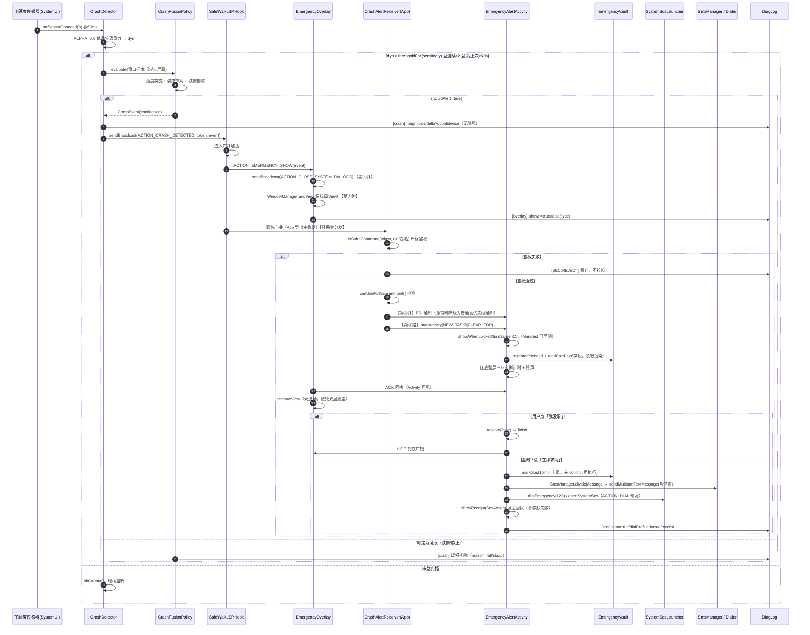
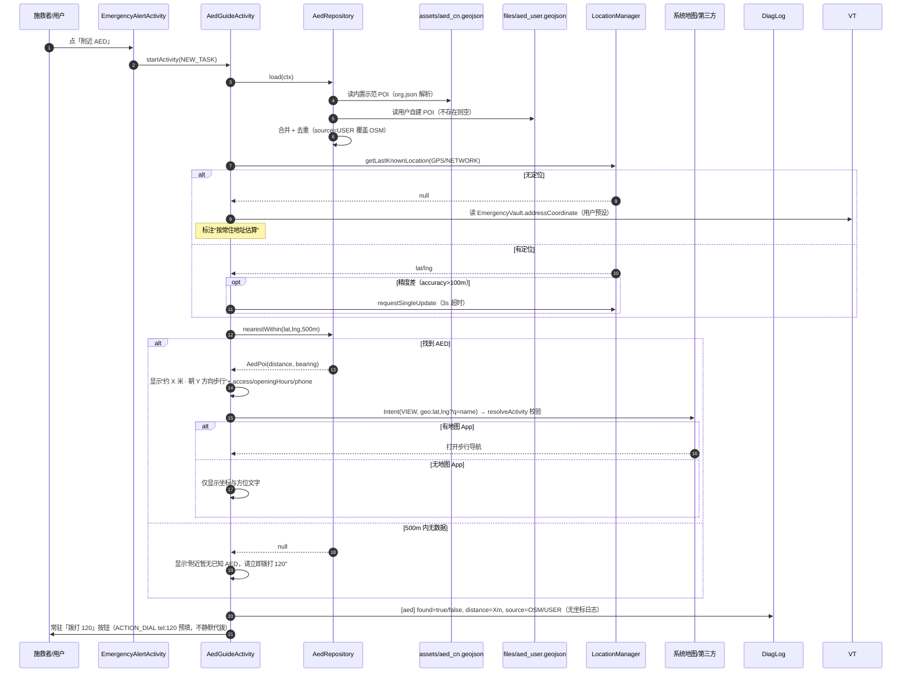
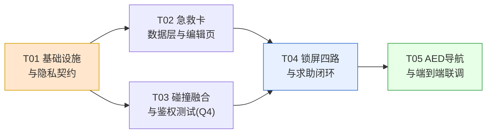

# SafeWalk「医疗急救卡功能」系统架构设计 + 任务分解

> 架构师：高见远（Gao） · 版本：v1.0（arch-emergency）
> 上游输入：产品经理许清楚 `safewalk_emedical_card v1.0` PRD
> 代码基线：`/workspace/io.github.wumisc.safewalk`，versionName **5.4.19** / versionCode **84**，AGP 9.x，Kotlin 2.4.21，minSdk **33** / targetSdk **35** / compileSdk **37**
> 核实方式：直接 Read/Grep 真实源码（非推测），核实清单见 §0 与 §10

---

## 0. 现状核实速览（先看差异，再看设计）

> 原则：**PRD 描述与真实代码不一致处，一律以真实代码为准**。以下 12 条是本次读码后确认的事实，后续所有设计均建立其上。

| # | PRD / 常识描述 | 真实代码（已核实） | 影响 |
|---|---|---|---|
| D1 | Q4 需确认 `EmergencyCommandSecurityTest` 覆盖范围 | **仅 4 个测试方法**，全部只调 `ReceiverCompat.isStrictCommand(receiver, token, expected)` 的**纯令牌匹配**分支；传入的是 `onReceive` 空实现的匿名 Receiver，**未模拟 uid / 包名 / API 版本** | `senderIsTrusted()` 的 true/false/null 三分支、`CrashAlertReceiver.onReceive()` 端到端、短信去重、FSI、锁屏字段、加密全部**零覆盖** |
| D2 | 「令牌硬编码」是待解决的隐患 | 令牌 `BROADCAST_TOKEN = "safewalk-bc-2.5"` 明写在 `SafeWalkDataStore.kt` 的 `SafeWalkPrefKey`；测试注释自己承认反编译可得 | 严格鉴权只能挡"随手发 Intent"，挡不住定向伪造；需靠 signature 权限 + 端到端测试补强 |
| D3 | P0-1「新增速度变化+姿态+屏幕融合」 | `CrashDetector.kt` 只有 **ALPHA=0.8 低通 + 2 连续采样 + 60s 冷却 + 动态加速度阈值 25/20/15 m/s²（≈2.5/2.0/1.5g）**，`SENSOR_DELAY_UI≈60ms`；**无任何速度/姿态/屏幕输入** | 融合层为**净新增**，算法骨架（PRD 要求不改）可保留为第一级门控 |
| D4 | 锁屏四路并用「①SystemUI 覆盖 View ②Activity ③FSI ④ACTION_CLOSE_SYSTEM_DIALOGS」 | 真实**只有 2 路**：`CrashAlertReceiver` 的 `startActivity()` + FSI 通知（`CHANNEL_CRASH`/IMPORTANCE_HIGH/CATEGORY_ALARM）。全仓 Grep 确认 Hook 层**没有 WindowManager.addView 急救覆盖层**，也**没有 ACTION_CLOSE_SYSTEM_DIALOGS** | 覆盖层与第 4 路为**净新增**；现有预览悬浮窗在 App 进程 `WalkPreviewService`（TYPE_APPLICATION_OVERLAY），角色不同，不可复用为锁屏层 |
| D5 | G3「不解锁可见 ≥6 关键字段、字号 ≥18sp」 | `EmergencyAlertActivity` 只显示 **4 个字段**（姓名/血型/联系人/住址），且血型、联系人、住址在 `activity_emergency_alert.xml` 中是 **15sp**（仅姓名 18sp）；值为明文 `SafePrefs.getString` 直读 | **G3 不达标**，需扩字段 + 统一 ≥18sp |
| D6 | 「急救卡全部本地加密」 | `EmergencyCardActivity.saveCard()` 用 `sp.edit().putString(...).commit()` 写入 `safewalk_xsp` **明文 SharedPreferences**；`docs/emergency-card-review-20261112.md` 第 68 行明确写"仍是明文…未加密；root 设备可读" | **加密为净新增**，且需做一次性迁移；不可直接改 key 名而丢老用户数据 |
| D7 | 「DiagLog 敏感字段脱敏」 | `DiagLog.log()` 直接 `Log.i(TAG, msg)` + 原文落盘，**无任何脱敏/过滤函数** | 脱敏为净新增；若先做求助链路后做脱敏，日志会真实记录姓名/号码 |
| D8 | 「系统 SOS 联动」 | 现状是 `EmergencyCardActivity.openSosSettings()` 的 5 个厂商 Activity 路径 try/catch + 设置主页兜底；**没有** `ACTION_DIAL` 预填 120 的联动按钮 | "跳设置页"≠"联动"；需新增 `SystemSosLauncher`（候选链 + resolveActivity 校验 + ACTION_DIAL 预填，不静默代拨） |
| D9 | 「急救卡字段扩展（血型可选、住址可选…）」 | 血型是自由文本 `EditText`（`android:inputType="textCapCharacters"`），**无 A/B/AB/O/其他/未知 + Rh 枚举**；紧急联系人**只有 1 个**；无年龄/性别/器官捐献/医保/多档案/隐私开关/医疗 QR | 字段模型与编辑页需重构；保留旧 key 兼容 |
| D10 | PRD 说「AED 导航」 | 全仓无 AED / GeoJSON / POI / Overpass 相关代码；`LocationModeEngine`/`ArrivalJudge` 是"到达目的地提醒"，与 AED 无关 | AED 为**全新模块**，P1 但属用户原始需求第 5 点，本设计纳入 |
| D11 | `ReceiverCompat` 注释写 minSdk=30 | 真实 `app/build.gradle` 是 **minSdk 33 / targetSdk 35 / compileSdk 37**；`registerExportedWithPermission` 里 API30~32 分支是历史死代码 | 文档以 build.gradle 为准；新增代码按 **API 33+ 为基线**，API34 的 `getSentFrom*` 仍需 null 兜底 |
| D12 | ConfigProvider 白名单边界 | 已核实：`WHITELIST` 全为功能开关与显示参数，**无任何医疗字段**；`isTrustedCaller()` 用 uid + `callingPackage` 放行 SystemUI（含 HyperOS 应用段 uid 兼容），`query()` 只认 `/config`，fail-closed | 契约健康，**继续严守**；但由此产生"SystemUI 覆盖层不能直接读医疗字段"的架构约束（见 §2.3） |

**另外两条正面事实（可复用，不必重造）**：

- **注入锚点已成熟**：`SafeWalkLSPHook.handleLoadPackage()` 已挂 3 个锚点 —— `com.android.systemui.SystemUIApplication.onCreate`、`android.app.Instrumentation.callApplicationOnCreate`、`com.android.systemui.SystemUIService.onCreate`，并有 `ActivityThread` 反射兜底 + 退避重试（2s→60s，最多 20 次）。新覆盖层直接挂在这条已有链路上即可。
- **省电骨架已成熟**：`PowerPolicy.tickIntervalMs()` 三档（关 5s / 静置 5s / 行走或预览 2s）；配置读取走后台单线程 `configExecutor` + `ACTION_CONFIG_CHANGED` 主动推送 + 60s 兜底轮询；心跳看门狗 30s。新增能力必须寄生在这套节拍上，不得另起高频轮询。

---

## 1. 实现方案总览

### 1.1 分层架构

系统按 **4 层 + 1 条隐私硬边界** 组织。核心矛盾是：**锁屏强提醒需要 SystemUI 进程Display，而医疗字段按契约绝不能跨进程导出**。解法是"**SystemUI 只出壳、App 进程出血肉**"——覆盖层负责抢占屏幕和 100% 触达，医疗内容由 App 进程的 `EmergencyAlertActivity`（showWhenLocked）承载；两层通过带签名权限的广播握手，不传任何医疗数据。



### 1.2 四路锁屏触达的精确定义（对齐 PRD Q1 边界）

| 路 | 承载者 | 进程 | 依赖 | 现状 | 本设计 |
|---|---|---|---|---|---|
| ① 系统级覆盖 View | `EmergencyOverlay`（Hook） | SystemUI（uid 1000） | SystemUI 存活；`TYPE_STATUS_BAR_PANEL`→`TYPE_APPLICATION_OVERLAY` 降级 | ❌ 无 | ✅ 新增；不依赖通知渠道、不依赖 FSI 权限 |
| ② 全屏 Activity | `EmergencyAlertActivity` | App | 进程可被拉起；Manifest 已 `showWhenLocked/turnScreenOn` + `singleTask` | ✅ 已有 | ✅ 扩展字段与按钮 |
| ③ FSI 通知 | `CrashAlertReceiver.showFullScreenNotification()` | App | `USE_FULL_SCREEN_INTENT`（Android 14+ 仅通话/闹钟默认授予，用户可撤销） | ✅ 已有 | ✅ 增加 `canUseFullScreenIntent()` 检测，撤销时降级并 DiagLog 留痕 |
| ④ `ACTION_CLOSE_SYSTEM_DIALOGS` | Hook 以 system uid 发送（App 侧发无效） | SystemUI 分发 | SystemUI 存活 | ❌ 无 | ✅ 新增；关闭遮挡的锁屏对话框，为 ②③ 让路 |

**不可达边界（书面明示，不承诺 100%）**：设备关机 / 电池耗尽 / SystemUI 崩溃或被强制停止 / LSPosed 作用域被取消。这四类场景在设置页与 README 明示；降级手段是"撞击判定瞬间预发一条短信回执"（若已授权 SEND_SMS），保证**至少有一条出设备的证据链**，并在 DiagLog 用 `[sos][fallback]` 事件标记。

### 1.3 隐私硬边界

```
ConfigProvider.WHITELIST  ── 可跨进程 ──> 功能开关 / 显示参数（含 enableCrashDetection、crashSensitivity、enableDiagLog）
EmergencyVault            ── 仅 App 进程 ──> 姓名/年龄/血型/Rh/住址/过敏/疾病/用药/联系人/医保/捐献意愿/QR
DiagLog                   ── 只记字段名与长度 ──> 永不记录上述字段的"值"
```

---

## 2. 框架 / 技术选型

### 2.1 各功能点选型总表

| 功能点 | 选型 | 为什么（基于真实代码） |
|---|---|---|
| 碰撞检测融合 | 保留 `CrashDetector` 的 `ALPHA=0.8` 低通 + 2 采样 + 60s 冷却作为**一级门控**；新增 `CrashFusionPolicy`（纯 Kotlin 函数）做二级判定 | PRD 交付口径"不改算法骨架"；纯函数便于 JVM 单测（现有 `CrashDetectorTest` 已是纯函数风格） |
| 速度变化 | 复用**同一路加速度计**积分得到粗速度估计（Δv = Σa·Δt，仅用于短窗 200ms），不新注册传感器 | 省电：不新增 listener、不新增 wake lock；`SENSOR_DELAY_UI≈60ms` 已够 |
| 姿态 / 跌倒排除 | 复用加速度静态分量夹角 + 现有 `DevicePosePolicy`/`AttitudeStabilizer` 的思路（提取纯函数，不引入陀螺仪常驻） | 组内已有 `AttitudeStabilizer.kt`/`DevicePosePolicy.kt` 可借鉴；跌倒排除是 PRD 明确要求 |
| 屏幕状态融合 | 读 `KeyguardManager.isDeviceLocked()` + 现有心跳/广播，**不轮询**；仅在撞击门控触发瞬间取一次 | 避免为屏幕状态开独立高频巡检 |
| 锁屏覆盖层 | LSPosed Hook 注入；锚点复用 `SystemUIApplication.onCreate` 等 3+1 条；`WindowManager.addView` 用 `TYPE_STATUS_BAR_PANEL`（system uid 可加）→ 失败降级 `TYPE_APPLICATION_OVERLAY`（`FLAG_SHOW_WHEN_LOCKED|FLAG_TURN_SCREEN_ON|FLAG_KEEP_SCREEN_ON|FLAG_LAYOUT_IN_SCREEN`） | 与真实锚点完全对齐；system uid 可绕开普通应用的 FSI 权限限制；失败降级覆盖 HyperOS/第三方 ROM |
| 覆盖层内容 | 只画**非隐私壳**：红底、"疑似撞击 · 正在载入急救卡"、120 按钮、"查看急救卡"按钮；**不渲染任何医疗字段** | 严守 ConfigProvider 隐私契约；医疗内容由 App Activity 显示，避免为 Hook 新开医疗数据通道 |
| 系统 SOS 联动 | `SystemSosLauncher`：候选 Intent 链（`ACTION_DIAL` + `tel:120`、系统 EmergencyAffordance 设置入口、厂商路径）+ 逐个 `resolveActivity()`；一律预填不静默代拨 | PRD 明确；AOSP `performEmergencyCall` 无公开 SDK 仅系统签名，不可调用 |
| 急救卡加密 | `androidx.security:security-crypto` 的 `EncryptedSharedPreferences`（MasterKey = AES256-GCM + AndroidKeyStore）；key 命名 `safewalk_emer_secure` | Jetpack 官方方案、无 GMS；密钥不出 TEE；与现有 `SafePrefs` 类型兜底兼容 |
| 医疗 QR | `com.google.zxing:core`（纯 Java 生成 Bitmap，无 GMS、无网络）；载荷用紧凑 JSON + 版本号 | 无 App 依赖即可被施救者扫码；ZXing core 不引入 Play Services |
| AED 数据 | Android 内置 `org.json` 解析 GeoJSON；内置 `assets/aed_cn.geojson` 示范点 + `files/aed_user.geojson` 用户自建；**不引 OSM/地图 SDK** | 无 GMS/云服务；国内 OSM 覆盖稀疏，用户自建是主路径；步导用 Haversine + 方位角 + 系统 `geo:` Intent |
| AED 定位 | `LocationManager.getLastKnownLocation()` → 单次 `requestSingleUpdate`（带 3s 超时）→ 用户预设住址坐标兜底 | 复用 `EmergencyAlertActivity.lastKnownLocationText()` 的现有模式；不新增长驻定位 |
| 日志脱敏 | `EmergencyDiag.redact(key, value)` 包装 `DiagLog.log()`：医疗字段只输出 `key=***(len=N)` | 修正 D7；事件命名保持 `[crash]/[sos]/[overlay]/[vault]/[aed]/[SEC:*]` 前缀体系 |

### 2.2 锁屏覆盖层的真实 SystemUI 锚点（可行落点）

现有 Hook 已在 `handleLoadPackage()` 中挂好锚点（D11 正面事实），新覆盖层**不新增 Hook 锚点**，只在 `runInit()` 中加一步：

```kotlin
// SafeWalkLSPHook.runInit() 内，紧跟 step("车祸检测") 之后
step("急救覆盖层") { EmergencyOverlay.install(ctx!!) }
```

`EmergencyOverlay.install()` 的内部落点：

| 步骤 | 实现要点 | 失败降级 |
|---|---|---|
| 1. 拿 Context | 直接复用 `runInit` 传入的 `appCtx.applicationContext`（已由 3 锚点之一或 ThreadPool 兜底拿到） | 无 → 覆盖层不可用，仍保留 ②③ 两路 |
| 2. 拿 WindowManager | `ctx.getSystemService(Context.WINDOW_SERVICE) as WindowManager`（在 SystemUI 进程即 system uid） | 抛异常 → DiagLog `[overlay] wm 不可用`，不阻塞 init |
| 3. 预创建 View 但**不 addView** | 只在收到 `ACTION_EMERGENCY_SHOW` 时才 `addView`；避免开机即占一层窗口的内存/绘制 | — |
| 4. 窗口类型 | 首选 `TYPE_STATUS_BAR_PANEL`（系统窗口层级，锁屏之上）；抛 `BadTokenException`/`SecurityException` 降级 `TYPE_APPLICATION_OVERLAY` | 两级都失败 → `[overlay] addView 失败`，仍靠 ②③ |
| 5. 关闭遮挡对话框 | addView 前以 system uid 发 `sendBroadcast(Intent(Intent.ACTION_CLOSE_SYSTEM_DIALOGS))`（App 侧发无效，必须 Hook 发） | 无回执可查，靠覆盖层层级本身 |
| 6. 生命周期 | 收到 `ACTION_EMERGENCY_HIDE` 或 Activity `onDestroy` 回执后 `removeView`；`try/catch` 包住，禁止把 SystemUI 主线程拖崩 | 残留 → tick 里 `OVERLAY_RESYNC_MS` 保鲜期补发 HIDE |

> **为什么不 hook `KeyguardViewMediator` / `NotificationShadeWindowController`**：这两类是锁屏 View 的理想挂载点，但各 ROM 改包名/改方法签名极其频繁（项目历史注释已多次记录 HyperOS 类名漂移）。复用已验证的 Application onCreate 锚点 + 系统 uid WindowManager，比 hook 锁屏内部类稳一个数量级；代价是无法精确控制锁屏动画层级，但急救场景"盖住即可"足够。

### 2.3 加密存储与迁移方案

```
旧（现状）: safewalk_xsp.xml  ← emerName/emerBlood/emerAddress/emerContactName/emerContactPhone/emerAllergy/emerCondition（明文）
                                  ↑ 其中 enableCrashDetection / crashSensitency 必须留在此处（要进白名单给 Hook 读）

新（目标）: safewalk_emer_secure.xml  ← EncryptedSharedPreferences（AES256-GCM / AndroidKeyStore）
           键：name/age/gender/bloodType/rh/address/allergy/allergySeverity/conditions/medications/
               contacts(JSON数组)/insuranceId/organDonation/qrPayload/privacyFlags/emergencyNumbers
```

**迁移规则（工程师必须遵守，否则老用户数据全丢）**：

1. `EmergencyVault.migrateIfNeeded(ctx)` 在 `EmergencyCardActivity.onCreate` 与 `EmergencyAlertActivity.onCreate` 各调一次（幂等，用 `emerVaultMigrated` 布尔标记，该标记**不放白名单**）。
2. 顺序：**读旧明文 → 写加密 → 校验读回一致 → 才 `remove()` 旧 key**。任何一步失败保留旧值，下次再试。
3. 旧 key 中 `enableCrashDetection`/`crashSensitivity`/`emerLastSosTs` 的处理：
   - 前两个**留在** `safewalk_xsp`（Hook 要从 ConfigProvider 读）；
   - `emerLastSosTs` 是隐私状态，迁到 Vault，同时**确认它本来就不在白名单**（已核实 D12）。
4. 读侧统一走 `EmergencyVault`，不再直接 `SafePrefs.getString(sp, emerXxx)`；`SafePrefs` 继续负责开关的类型兜底，不改其行为。
5. 加密失败（KeyStore 不可用 / 设备无锁屏）→ 降级到**内存态 + 明确 UI 提示"本次未落盘"**，绝不静默回退明文。

### 2.4 AED 数据方案（无网/无数据兜底优先）

| 层次 | 内容 | 兜底 |
|---|---|---|
| 数据 | `AedPoi(id,name,lat,lng,address,access,openingHours,phone,source,verifiedAt)`；内置 `assets/aed_cn.geojson`（少量示范）+ 用户 `files/aed_user.geojson` | 内置为空时显示"附近暂无已知 AED" |
| 查询 | Haversine 求 500m 内最近点（PRD G6 口径），按距离排序 | 无定位 → 用用户预设住址坐标，并标注"按常住地址估算" |
| 引导 | 显示"约 X 米 · 朝 Y 方向步行" + 系统地图 `geo:lat,lng?q=name` 跳转（`resolveActivity` 校验） | 无地图 App → 只显示坐标与方位文字 |
| 无网 | 全部计算本地完成，**零网络请求**；不引 Overpass 在线查询（PRD Q6 本期仅 OSM+自建） | 100% 显示"请立即拨打 120" + `ACTION_DIAL tel:120` 按钮 |

---

## 3. 文件列表及相对路径

> 路径均相对 `/workspace/io.github.wumisc.safewalk/`。**新增 13 个，修改 12 个**。注意：`SafeWalkPrefKey` / `SafeWalkConfig` 定义在 `SafeWalkDataStore.kt` 中（不是同名文件），改常量要动这个文件。

### 3.1 新增文件

| 路径 | 职责 | 所属任务 |
|---|---|---|
| `app/src/main/java/io/github/wumisc/safewalk/EmergencyCard.kt` | 急救卡数据模型（`EmergencyCard`, `BloodType` 枚举含 `OTHER/UNKNOWN`, `RhFactor`, `EmergencyContact`, `PrivacyFlags`），序列化/反序列化 | T02 |
| `app/src/main/java/io/github/wumisc/safewalk/EmergencyVault.kt` | EncryptedSharedPreferences 封装 + 旧明文迁移 + 脱敏读取 API | T02 |
| `app/src/main/java/io/github/wumisc/safewalk/MedicalQr.kt` | ZXing QR 生成（紧凑 JSON + version），无 App 依赖可读 | T02 |
| `app/src/main/java/io/github/wumisc/safewalk/CrashFusionPolicy.kt` | 纯函数：速度突变/姿态/屏幕/跌倒排除二级判定，输出 `CrashEvent` | T03 |
| `app/src/main/java/io/github/wumisc/safewalk/EmergencyOverlay.kt` | Hook 进程：SystemUI WindowManager 系统级覆盖层 + `ACTION_CLOSE_SYSTEM_DIALOGS` | T04 |
| `app/src/main/java/io/github/wumisc/safewalk/SystemSosLauncher.kt` | 系统 SOS 候选链 + `resolveActivity` 校验 + `ACTION_DIAL` 预填 | T04 |
| `app/src/main/java/io/github/wumisc/safewalk/AedPoi.kt` | AED POI 数据模型 + GeoJSON 解析（org.json） | T05 |
| `app/src/main/java/io/github/wumisc/safewalk/AedRepository.kt` | 内置 + 用户 POI 合并、Haversine、500m 检索、导入导出 | T05 |
| `app/src/main/java/io/github/wumisc/safewalk/AedGuideActivity.kt` | AED 列表 + 步行引导 + 120 兜底 UI | T05 |
| `app/src/main/java/io/github/wumisc/safewalk/EmergencyDiag.kt` | DiagLog 脱敏包装：`redact()` / `logCard()`，事件命名常量 | T01 |
| `app/src/main/assets/aed_cn.geojson` | 内置 AED 示范 POI（FeatureCollection，含 source=OSM） | T05 |
| `app/src/test/java/io/github/wumisc/safewalk/CrashFusionPolicyTest.java` | 融合判定单测：速度/姿态/跌倒排除/边界 | T03 |
| `app/src/test/java/io/github/wumisc/safewalk/EmergencyVaultTest.java` | 迁移幂等、加密读回、失败不回退明文 | T02 |

### 3.2 修改文件

| 路径 | 修改内容 | 所属任务 |
|---|---|---|
| `app/build.gradle` | 新增 `androidx.security:security-crypto` / `com.google.zxing:core`；测试依赖补 `androidx.test:runner`（如需） | T01 |
| `app/src/main/AndroidManifest.xml` | 新增 `EmergencyOverlay` 不需要组件（Hook 内）；新增 `AedGuideActivity`；`CrashAlertReceiver` 增加 `ACTION_EMERGENCY_SHOW/HIDE`；确认 `USE_FULL_SCREEN_INTENT` 与 signature `CONTROL` 保留 | T01/T04/T05 |
| `app/src/main/java/io/github/wumisc/safewalk/SafeWalkDataStore.kt` | 在 `SafeWalkPrefKey` 增加新 key/action/token；**严禁**把任何医疗字段加入 `ConfigProvider.WHITELIST`；`SafeWalkConfig.exportConfig` 保持白名单过滤 | T01 |
| `app/src/main/java/io/github/wumisc/safewalk/ConfigProvider.kt` | 增加启动期断言（单测）：`WHITELIST ∩ MEDICAL_KEYS = ∅`；`isTrustedCaller` 不变 | T01 |
| `app/src/main/java/io/github/wumisc/safewalk/DiagLog.kt` | 暴露 `redact()` 钩子（由 `EmergencyDiag` 调用），`logThrottled` 支持脱敏通道 | T01 |
| `app/src/main/java/io/github/wumisc/safewalk/CrashDetector.kt` | 采集窗口数据喂给 `CrashFusionPolicy`；保留原阈值/冷却/采样；广播增加 `CrashEvent` extras | T03 |
| `app/src/main/java/io/github/wumisc/safewalk/ReceiverCompat.kt` | 可选：`isStrictCommand` 补 KDoc 说明测试边界；逻辑不变 | T03 |
| `app/src/main/java/io/github/wumisc/safewalk/SafeWalkLSPHook.kt` | `runInit` 增 `step("急救覆盖层")`；configChanged 时同步覆盖层开关；`ACTION_EMERGENCY_HIDE` 回执校准 | T04 |
| `app/src/main/java/io/github/wumisc/safewalk/CrashAlertReceiver.java` | 严格鉴权后增发 `ACTION_EMERGENCY_SHOW`（Hook 接收）+ FSI 可用性检测 + 可见回执 | T04 |
| `app/src/main/java/io/github/wumisc/safewalk/EmergencyAlertActivity.java` | 从 `EmergencyVault` 读 ≥6 字段；新增系统SOS/AED/QR 按钮；求助后**可见回执**；FSI 撤销降级 | T04 |
| `app/src/main/res/layout/activity_emergency_alert.xml` | 字段 ≥6、关键字段 ≥18sp、按钮区扩展，保持红底高对比 | T04 |
| `app/src/main/java/io/github/wumisc/safewalk/EmergencyCardActivity.java` | 血型/Rh 下拉、年龄/性别、≥3 联系人、捐献/医保、隐私开关、QR、迁移调用 | T02 |
| `app/src/main/res/layout/activity_emergency.xml` | 对应新增控件；保留既有"复制到系统紧急信息"卡片（Q3 联动不替代） | T02 |
| `app/src/test/java/io/github/wumisc/safewalk/EmergencyCommandSecurityTest.java` | **补齐 Q4**：uid 三分支、端到端、去重、FSI、锁屏字段、加密脱敏共 6 组 | T03 |
| `app/src/test/java/io/github/wumisc/safewalk/CrashDetectorTest.java` | 增加融合判定与降级门控用例（原 2 个阈值用例保留） | T03 |

> 修改文件 15 个（上表），其中部分跨任务；以任务小节中的"涉及文件"为准。

---

## 4. 数据结构与接口（Mermaid classDiagram）

```mermaid
classDiagram
    %% ===== 数据模型 =====
    class EmergencyCard {
        +String id
        +String name
        +Int age
        +Gender gender
        +BloodType bloodType
        +RhFactor rh
        +String address
        +String allergy
        +Boolean allergySevere
        +String conditions
        +String medications
        +List~EmergencyContact~ contacts
        +String insuranceId
        +Boolean organDonation
        +PrivacyFlags privacy
        +Long updatedAt
        +String qrPayload() String
        +static fromJson(String) EmergencyCard
        +String toJson() String
    }
    class EmergencyContact {
        +String name
        +String phone
        +String relation
        +Boolean primary
    }
    class BloodType {
        <<enumeration>>
        A
        B
        AB
        O
        OTHER
        UNKNOWN
    }
    class RhFactor {
        <<enumeration>>
        POSITIVE
        NEGATIVE
        UNKNOWN
    }
    class PrivacyFlags {
        +Boolean showBloodOnLock
        +Boolean showAddressOnLock
        +Boolean allowSmsLocation
        +Boolean allowQr
    }

    class CrashEvent {
        +Long timestampMs
        +Float magnitude
        +Float deltaV
        +Float poseAngle
        +Boolean screenOff
        +Boolean fallExcluded
        +Float confidence
        +Int sensitivity
        +Boolean shouldAlert() Boolean
    }
    class SosAction {
        +Long eventId
        +SosType type
        +String targetPhone
        +Boolean smsSent
        +Boolean dialPrefilled
        +Boolean systemSosOpened
        +String receipt
        +Long executedAt
    }
    class AedPoi {
        +String id
        +String name
        +Double lat
        +Double lng
        +String address
        +String access
        +String openingHours
        +String phone
        +String source
        +Long verifiedAt
        +Double distanceTo(Double,Double) Double
    }

    %% ===== 存储 / 服务 =====
    class EmergencyVault {
        -SharedPreferences enc
        +init(Context) void
        +migrateIfNeeded(Context) Boolean
        +readCard() EmergencyCard
        +saveCard(EmergencyCard) Boolean
        +lastSosTs() Long
        +markSos(SosAction) void
        +clear() void
    }
    class EmergencyDiag {
        +redact(String,String) String
        +logCard(String,EmergencyCard) void
        +event(String,String) void
    }
    class ConfigProvider {
        +Set~String~ WHITELIST
        +isTrustedCaller() Boolean
        +query(...) Cursor
    }
    class SafeWalkConfig {
        +exportConfig(Context) void
        +loadConfig(Context) JSONObject
    }

    %% ===== SystemUI Hook 层 =====
    class SafeWalkLSPHook {
        -CrashDetector crashDetector
        -EmergencyOverlay overlay
        -JSONObject configJson
        +handleLoadPackage(lp) void
        +runInit(ctx) void
        +updateCrashDetection() void
        +tickRunnable() Runnable
    }
    class CrashDetector {
        -Float ALPHA
        -Int HIT_COUNT_REQUIRED
        -Long TRIGGER_COOLDOWN_MS
        +thresholdFor(Int) Float
        +onSensorChanged(e) void
        -onCrashDetected(e) void
    }
    class CrashFusionPolicy {
        +evaluate(samples,pose,screen) CrashEvent
        +excludeFall(...) Boolean
        +deltaV(samples) Float
    }
    class EmergencyOverlay {
        -WindowManager wm
        -View root
        +install(Context) void
        +show(CrashEvent) Boolean
        +hide() void
        +closeSystemDialogs() void
    }

    %% ===== App 进程层 =====
    class CrashAlertReceiver {
        +onReceive(c,i) void
        -showFullScreenNotification(c) void
    }
    class EmergencyAlertActivity {
        -EmergencyCard card
        -Int remain
        +loadCard() void
        +startCountdown() void
        +resolve(Boolean sos) void
        -doSos() void
        -showReceipt(SosAction) void
    }
    class EmergencyCardActivity {
        -EmergencyCard draft
        +saveCard() void
        +copyCard() void
        +openSosSettings() void
    }
    class SystemSosLauncher {
        +openSystemSos(Context) Boolean
        +dialEmergency(Context,String) Boolean
        -resolveFirst(Intent) Boolean
    }
    class AedRepository {
        +load(Context) List~AedPoi~
        +nearestWithin(Double,Double,Int) AedPoi
        +importGeoJSON(Context,String) Int
        +exportGeoJSON(Context) String
    }
    class AedGuideActivity {
        -AedPoi target
        +render() void
        +openInMap() void
        +dial120() void
    }
    class ReceiverCompat {
        +isStrictCommand(r,t,expected) Boolean
        +senderIsTrusted(r) Boolean
        +registerExportedWithPermission(...) void
    }

    %% ===== 关系 =====
    EmergencyCard "1" *-- "0..*" EmergencyContact
    EmergencyCard --> BloodType
    EmergencyCard --> RhFactor
    EmergencyCard --> PrivacyFlags
    EmergencyVault ..> EmergencyCard : 读写
    EmergencyVault ..> CrashEvent : 记录去重
    EmergencyDiag ..> EmergencyCard : 脱敏输出
    EmergencyDiag --> DiagLog

    SafeWalkLSPHook "1" *-- "1" CrashDetector
    SafeWalkLSPHook "1" *-- "1" EmergencyOverlay
    CrashDetector ..> CrashFusionPolicy : 二级判定
    CrashFusionPolicy ..> CrashEvent : 产出
    SafeWalkLSPHook ..> ConfigProvider : 只读取白名单
    ConfigProvider ..> SafeWalkConfig : 同源配置

    CrashAlertReceiver ..> ReceiverCompat : 严格鉴权
    CrashAlertReceiver ..> EmergencyAlertActivity : 拉起
    CrashAlertReceiver ..> EmergencyOverlay : SHOW 广播
    EmergencyAlertActivity ..> EmergencyVault : 读卡/去重
    EmergencyAlertActivity ..> SystemSosLauncher : 联动
    EmergencyAlertActivity ..> AedGuideActivity : 附近AED
    EmergencyAlertActivity ..> SosAction : 产出
    EmergencyCardActivity ..> EmergencyVault : 保存/迁移
    EmergencyCardActivity --> MedicalQr
    AedGuideActivity ..> AedRepository
    AedRepository "1" *-- "0..*" AedPoi
```



---

## 5. 程序调用流程（3 条关键时序图）

### 5.1 时序①：碰撞检测 → 锁屏四路强提醒 → 求助闭环



### 5.2 时序②：急救卡编辑 → 加密存储 → 跨进程读取（隐私边界）

```mermaid
sequenceDiagram
    autonumber
    participant U as 用户
    participant EC as EmergencyCardActivity
    participant VT as EmergencyVault
    KP as AndroidKeyStore
    participant SP as safewalk_xsp
    participant SF as SafeWalkConfig
    participant CP as ConfigProvider
    participant HK as SafeWalkLSPHook(ConfigExecutor)
    participant MQ as MedicalQr
    participant DL as DiagLog

    U->>EC: 编辑血型(A/B/AB/O/其他/未知)+Rh+≥3联系人+住址+过敏
    EC->>VT: migrateIfNeeded(ctx)
    VT->>SP: 读旧明文 emerName/emerBlood/...
    VT->>KP: 取/建 MasterKey(AES256-GCM)
    KP-->>VT: key handle（不出 TEE）
    VT->>VT: 写 safewalk_emer_secure（EncryptedSharedPreferences）
    VT->>VT: 校验读回一致 → remove 旧 key（幂等）
    VT-->>EC: migrated=true
    EC->>VT: saveCard(EmergencyCard)
    VT-->>EC: ok（失败则 UI 提示"本次未落盘"）
    EC->>SF: exportConfig(ctx)
    SF->>SP: 只读 WHITELIST 字段（enableCrashDetection/crashSensitivity...）
    Note over SF,CP: 医疗字段 ❶ 不进 safewalk_config.json ❷ 不进 WHITELIST
    SF->>SP: 写 safewalk_config.json（files/，MODE_PRIVATE）
    SF->>HK: ACTION_CONFIG_CHANGED(token)
    HK->>CP: contentResolver.query(content://.../config)（后台单线程）
    CP->>CP: isTrustedCaller(): uid==1000 或 SystemUI 包名 → 放行
    CP-->>HK: 白名单 JSON（仅开关，无医疗字段）
    HK->>HK: 整体替换 volatile configJson
    HK->>HK: updateCrashDetection() 立即生效
    U->>EC: 点「生成医疗 QR」
    EC->>MQ: encode(card, version=1)
    MQ-->>EC: Bitmap（紧凑 JSON 载荷）
    EC->>DL: [vault] saved=true; [emergency] qr_generated（只记字段名/长度）
```

### 5.3 时序③：AED 导航完整流程（无网可用）



---

## 6. 省电与性能约束

> 总原则：**不新增任何常驻高频轮询、不新增 wake lock、不新增传感器监听器**。所有新能力寄生在既有 `PowerPolicy` tick 与既有加速度回调上。

| 约束项 | 延续现状 | 新增能力如何遵守 |
|---|---|---|
| tick 节拍 | `PowerPolicy.tickIntervalMs()`：总开关关 5s / 静置 5s / 行走或预览 2s | AED 缓存刷新、覆盖层保鲜期检查挂到**静置 5s 分支**，且加 `TTL=24h` 与"仅在充电/解锁态刷新"双重门限；**绝不缩短 tick 间隔** |
| 加速度采样 | `CrashDetector` 用 `SENSOR_DELAY_UI≈60ms`，且仅在 `masterEnable && enableCrashDetection` 时注册（`updateCrashDetection` 已实现） | 速度/姿态融合在**同一次 `onSensorChanged` 回调内**计算，不 registerListener 第二次；屏幕状态在门控触发瞬间取一次，不订阅广播常驻 |
| 配置跨进程 | 后台单线程 `configExecutor` + `ACTION_CONFIG_CHANGED` 推送 + 60s 兜底 | 新增开关（覆盖层、AED）同样只在 `configChangedReceiver` 里刷新一次；医疗字段**永不**进入这条链路 |
| 看门狗心跳 | App 每 30s 发心跳给 Hook（`KeepAlivePolicy`） | 覆盖层 ACK 复用现有 `previewStateReceiver` 校准模式，不新开心跳通道 |
| 日志 I/O | `DiagLog.enabled` 总开关；`logThrottled(key, reason, changedMs, stableMs)` | 撞击/覆盖层/AED 事件全部走 `logThrottled`；`EmergencyDiag` 脱敏后再写；禁止在传感器回调里写文件 |
| 加密 | — | `EncryptedSharedPreferences` 只做**按需解密**（`readCard()`），不做常驻明文缓存；Activity `onDestroy` 清引用 |
| QR | — | 只在用户点击时生成一次 Bitmap，`onDestroy` 回收，不缓存 |
| AED | — | 500m 检索是纯内存 Haversine（几十个点，<1ms）；GeoJSON 解析只在 `load()` 时做一次并缓存，无网络 |
| FSI | Android 14+ 用户可撤销 | 撤销后不重试、不轮询检测，只在下次撞击时检测一次并降级，DiagLog 留痕 |

**功耗验收口径**：对比基线版本，在"总开关开 + 静置 8 小时"场景下，`adb shell dumpsys batterystats` 的 Wakefulness / Sensor 唤醒次数**不增加**（新增检测仅在开关打开时按原有注册策略运行，tick 间隔不变）。

---

## 7. 有序任务列表（按依赖顺序，≤5 个任务）

| 任务 | 名称 | 依赖 | 优先级 | 涉及文件（≥3） |
|---|---|---|---|---|
| **T01** | 基础设施与隐私契约 | — | P0 | `app/build.gradle`、`AndroidManifest.xml`、`SafeWalkDataStore.kt`、`ConfigProvider.kt`、`DiagLog.kt`(新增 `EmergencyDiag.kt`) |
| **T02** | 急救卡数据层与编辑页 | T01 | P0 | `EmergencyCard.kt`、`EmergencyVault.kt`、`MedicalQr.kt`、`EmergencyCardActivity.java`、`activity_emergency.xml` |
| **T03** | 碰撞检测融合与鉴权测试强化 | T01 | P0 | `CrashFusionPolicy.kt`、`CrashDetector.kt`、`CrashDetectorTest.java`、`EmergencyCommandSecurityTest.java`、`ReceiverCompat.kt` |
| **T04** | 锁屏四路强提醒与求助闭环 | T01, T02, T03 | P0 | `EmergencyOverlay.kt`、`SystemSosLauncher.kt`、`SafeWalkLSPHook.kt`、`CrashAlertReceiver.java`、`EmergencyAlertActivity.java`、`activity_emergency_alert.xml` |
| **T05** | AED 导航与端到端联调 | T04 | P1 | `AedPoi.kt`、`AedRepository.kt`、`AedGuideActivity.kt`、`assets/aed_cn.geojson`、`AndroidManifest.xml` |

> T02 与 T03 只依赖 T01，可**并行开发**；T04 需要两者的产物（Vault 读卡 + Fusion 事件）才能联调；T05 依赖 T04 的 AED 入口按钮。

### T01 — 基础设施与隐私契约

- **目标**：先把依赖、权限、key 常量、脱敏出口和"白名单不变式"立起来，为后续所有任务提供稳定地基。
- **要点**：
  1. `app/build.gradle` 新增：`androidx.security:security-crypto:1.1.0-alpha06`、`com.google.zxing:core:3.5.3`。
  2. `SafeWalkDataStore.kt` 的 `SafeWalkPrefKey` 增加：`emerAge/emerGender/emerBloodType/emerRh/emerAllergySevere/emerMedications/emerContacts/emerInsuranceId/emerOrganDonation/emerPrivacyFlags/emerVaultMigrated`；新增 action：`ACTION_EMERGENCY_SHOW`、`ACTION_EMERGENCY_HIDE`；**保持 `emerName/emerBlood/...` 旧 key 名不变**（迁移要用）。
  3. **硬约束**：上述医疗 key **一个都不能进** `ConfigProvider.WHITELIST`；在 `ConfigProvider` companion 增加 `MEDICAL_KEYS` 集合供单测断言。
  4. `EmergencyDiag.kt` 定义事件前缀常量与 `redact()`；`DiagLog.kt` 暴露钩子。
- **验收点**：
  - `./gradlew :app:testDebugUnitTest` 全绿（含新断言 `WHITELIST ∩ MEDICAL_KEYS == ∅`）。
  - 编译通过，minSdk33/targetSdk35 不变；Manifest 权限未被误删。

### T02 — 急救卡数据层与编辑页

- **目标**：把明文卡变加密卡，字段补齐到 PRD 全集（血型/Rh 可选、≥3 联系人、年龄、捐献、医保、QR、隐私开关）。
- **要点**：`EmergencyVault.migrateIfNeeded` 幂等 + 校验读回后才删旧 key；血型用 `BloodType` 枚举下拉（A/B/AB/O/其他/未知），Rh 用 `RhFactor`；编辑页保留"复制到系统紧急信息"卡片（Q3 联动不替代）。
- **验收点**：
  - `EmergencyVaultTest`：迁移执行 2 次结果一致；加密读回等于写入；KeyStore 失败时**不产生明文副本**。
  - 老用户升级：旧明文 7 字段全部可见于新加密卡，且 `safewalk_xsp` 中对应 key 已消失。
  - 卡片字段数 ≥ PRD 表；关键字段编辑后可保存并回显。

### T03 — 碰撞检测融合与鉴权测试强化（**Q4 主战场**）

- **目标**：在不改算法骨架前提下补二级融合；**把 `EmergencyCommandSecurityTest` 从 4 个纯 token 测试扩成覆盖 6 组**。
- **Q4 必须补齐的 6 组测试（工程师照此实现）**：
  1. `senderIsTrusted` 三分支：API34+ 系统 uid → true；应用段 uid + SystemUI 包名 → true；应用段 uid + 第三方包名 → **false**；API33 反射不可用 → null。
  2. `isStrictCommand` 严格语义：token 正确但 `senderIsTrusted=false` → **拒绝**（现有 4 个测试未覆盖此分支，用 Robolectric 反射注入 `mSentFromUid/mSentFromPackage` 模拟）。
  3. 端到端 `CrashAlertReceiver.onReceive()`：伪造广播 → **不** `startActivity`、不发 FSI；合法广播 → 拉起 `EmergencyAlertActivity`（Robolectric `ShadowApplication.getNextStartedActivity()`）。
  4. 去重：10 分钟内第二次 `doSos()` 跳过；`emerLastSosTs` 先落盘后执行（模拟进程被杀仍不重发）。
  5. 锁屏字段：Activity 创建后 ≥6 字段 TextView 非空、关键字段 `textSize>=18sp`（`getResources().getDimension()` 断言）。
  6. 脱敏：`EmergencyDiag.logCard()` 输出**不含**真实姓名/号码，只含 `***(len=N)`；`DiagLog` 落盘同。
- **验收点**：新增/修改后 `EmergencyCommandSecurityTest` ≥ 12 个测试方法；原 4 个保留；`CrashFusionPolicyTest` 覆盖跌倒排除、静止门控、速度突变、边界值。

### T04 — 锁屏四路强提醒与求助闭环

- **目标**：把"两路"变"四路"，把"4 字段/15sp"变"≥6 字段/≥18sp"，把静默失败变可见回执。
- **要点**：
  1. `EmergencyOverlay.install()` 挂到 `SafeWalkLSPHook.runInit()` 的 `step("急救覆盖层")`；**只画非隐私壳**，不渲染医疗字段。
  2. 第④路 `ACTION_CLOSE_SYSTEM_DIALOGS` 必须由 **Hook（system uid）** 发出；App 侧发无效。
  3. `CrashAlertReceiver` 先严格鉴权 → 再发 SHOW → FSI 可用性检测 → 拉起 Activity；Activity 起来后回 ACK，覆盖层 `removeView`。
  4. `EmergencyAlertActivity` 从 Vault 读卡；新增系统 SOS / 附近 AED / 医疗 QR 按钮；`showReceipt()` 用 TextView/Toast 明示"短信已发/拨号盘已打开/未设置联系人"。
  5. FSI 被撤销时降级：普通高优先级通知 + DiagLog `[sos][fallback]`，不静默。
- **验收点**：
  - 6 类锁屏状态矩阵（锁屏亮屏/熄屏/勿扰/静音/App 前台/App 后台）逐项真机或 Robolectric 断言可见；P95 ≤1.5s（用 DiagLog 时间戳 `[crash]→[overlay] shown` 计算）。
  - 覆盖层不显示任何医疗字段（代码检视 + 截图核验）。
  - 未设联系人时不 `finish()`，页面给出可见原因（修正现状逻辑：现状 `doSos` 里已实现，需保持）。

### T05 — AED 导航与端到端联调

- **目标**：用户原始需求第 5 点；500m 可用率 ≥90%，无数据 100% 提示拨 120。
- **要点**：`AedRepository` 纯本地 GeoJSON + Haversine；`AedGuideActivity` 三态 UI（找到/无数据/无定位）；`geo:` Intent 跳转前 `resolveActivity`。
- **验收点**：
  - 断网飞行模式下，500m 内置 POI 可检出并显示方位；清空数据后 100% 显示 120 兜底按钮。
  - 用户自建 GeoJSON 导入/导出 round-trip 一致。
  - 全链路端到端：撞击 → 四路 → 卡显示 → AED → 120 预填，DiagLog 事件链完整可回溯。

### 7.1 任务依赖图



---

## 8. 依赖包列表

### 8.1 已在 `app/build.gradle`（无需新增）

| 包 | 版本 | 用途 |
|---|---|---|
| `de.robv.android.xposed:api` | 82 (compileOnly) | LSPosed Hook API |
| `com.google.android.material:material` | 1.12.0 | SwitchCompat 等现有控件 |
| `org.jetbrains.kotlinx:kotlinx-coroutines-android` | 1.7.3 | 后台配置读取 |
| `androidx.core:core-ktx` | 1.13.1 | Compat |
| `top.yukonga.miuix.kmp:*` | 0.9.4 | Miuix 组件 |
| `androidx.compose.*` | BOM 2024.12.01 | Compose（本功能沿用现有 View 体系，不强制 Compose 重写） |
| `junit:junit` | 4.13.2 / `org.robolectric:robolectric:4.17` | 单测（T03 扩测直接用） |
| `androidx.test:core/rules` | 1.6.1 | Robolectric 断言 |

### 8.2 需新增（T01 统一加入）

```
androidx.security:security-crypto:1.1.0-alpha06   // 急救卡加密存储（AndroidKeyStore + AES256-GCM）
com.google.zxing:core:3.5.3                        // 医疗 QR 生成（纯 Java，无 GMS / 无网络）
```

> **明确不引入**：GMS / Firebase / 任何云服务 SDK；OSM/Mapbox/OSMDroid 地图 SDK；Overpass 在线客户端；TFLite（P2，本期不做）。GeoJSON 用 Android 内置 `org.json`，QR 用 ZXing core，均为纯本地。

---

## 9. 共享知识 / 跨文件约定（工程师必读）

1. **令牌与签名权限**：所有跨进程广播必须带 `SafeWalkPrefKey.EXTRA_BROADCAST_TOKEN`（值 `safewalk-bc-2.5`）；Hook 侧接收器用 `ReceiverCompat.registerExportedWithPermission(..., "io.github.wumisc.safewalk.permission.CONTROL")` 注册（signature 级，分发阶段挡第三方），令牌是第二道。**撞击广播在 App 侧必须走 `isStrictCommand`**（`senderIsTrusted=false` 时拒绝）。注意令牌硬编码是已知残留风险（D2），不要在外部分发。
2. **ConfigProvider 白名单铁律**：`WHITELIST` 只放功能开关与显示参数。**任何医疗字段（含 `emerLastSosTs`、`emerVaultMigrated`、QR 载荷、AED 用户备注）永不加入**；`SafeWalkConfig.exportConfig` 的白名单过滤逻辑不可绕过；新增开关若只 App 用（如 `enableAedGuide`）也不进白名单。
3. **DiagLog 事件命名**：沿用前缀体系 `[crash]` `[sos]` `[overlay]` `[vault]` `[emergency]` `[aed]` `[SEC:REJECT]` `[SEC:COMPAT]` `[hook]` `[keep]`；新增事件必须带前缀，便于 `grep` 组证据链。高频点一律 `logThrottled`。
4. **隐私脱敏规则**：医疗字段的值**永不**出现在 `Log.i`、DiagLog 文件、崩溃堆栈、Intent extra（跨进程）、ConfigProvider Cursor。只允许输出 `字段名=***(len=N)` 或布尔标志。AED 坐标不写日志（可写"found/distance"）。
5. **进程边界**：`EmergencyVault` / 医疗字段**只在 App 进程访问**；SystemUI Hook 只读 `ConfigProvider` 白名单 JSON。覆盖层与 App 之间的广播只传"事件 ID / confidence / token"，**不传卡内容**。
6. **时间与去重**：跨进程时间戳统一 `System.currentTimeMillis()`（wall clock 可比）；看门狗/冷却用 `SystemClock.elapsedRealtime()`。撞击冷却 60s（`CrashDetector`），求助去重 10min（`SOS_DEDUP_MS`，先 `commit()` 再执行）。
7. **Activity 单实例**：`EmergencyAlertActivity` 必须保持 `launchMode="singleTask"` + `showWhenLocked`/`turnScreenOn`（Manifest 已有，勿改），防止两条拉起通道各跑一轮倒计时导致重复发短信/拨号。
8. **初始化幂等**：Hook 的 `runInit` 已有 `initLock`/`initSucceeded`/`step()` 兜底；新增 `step("急救覆盖层")` 必须自己 `try/catch`，失败不能影响心跳等其他步骤。
9. **Kotlin/Java 混编**：新增纯逻辑用 Kotlin 对象 + `@JvmStatic`（对齐 `PowerPolicy`/`CrashFusionPolicy` 风格）；现有 Java Activity 改动保持 Java，通过 `@JvmStatic` 调用 Kotlin 单例。
10. **UI 体系**：本功能沿用现有 View/XML（与 `EmergencyCardActivity`/`EmergencyAlertActivity` 一致），**不强制改写为 Compose**；Miuix/Compose 留给主导航既有页面。

---

## 10. 待明确事项（Q1–Q6 逐条架构结论 + 读码新增差异）

### 10.1 PRD Q1–Q6 架构侧结论

| 编号 | 问题 | 架构侧建议结论 | 依据 |
|---|---|---|---|
| **Q1** | "100%"是否接受"开机+SystemUI存活"前提 | **接受，书面明示边界**。定义四路覆盖 + 不可达显式降级（撞击瞬间预发 SMS 回执）+ DiagLog 证据链；设置页/README 写清"关机/没电/SystemUI崩溃/强停不承诺" | PRD 建议 + D4（现状仅两路）+ 系统安全模型（普通 App 无法在关机后工作） |
| **Q2** | 车祸检测默认开关 | **保持默认关**（`enableCrashDetection` 默认 `false`，`EmergencyCardActivity` 已如此）；首启引导放进 `PermissionOnboardingActivity`，不在本功能改默认值 | 已核实代码 `SafePrefs.getBool(sp, enableCrashDetection, false)` |
| **Q3** | 跳转系统医疗信息 vs 自建 | **P1 跳转联动，不替代自建**。保留 `copyCard()` + `openSosSettings()`（已实现的 5 厂商路径），同时自建锁屏强提醒；系统医疗信息无公开写入 API，不可能自动填充 | D8 + `docs/emergency-card-review-20261112.md` 第 61 行 |
| **Q4** | 测试覆盖范围 | **见 §0 D1/D2 与 T03 的 6 组清单**。真实仅 4 个纯 token 测试；必须补 uid 三分支、端到端、去重、锁屏字段、脱敏、FSI 六组 | 直接读 `EmergencyCommandSecurityTest.java`（共 57 行、4 个 `@Test`） |
| **Q5** | 紧急号码表 | **内置 120/110 + 可编辑**；实现 `EmergencyNumbers` 存 Vault（用户偏好，不进白名单）；`ACTION_DIAL` 预填不静默代拨 | PRD 建议 + 合规（无公开代拨紧急号码 API） |
| **Q6** | AED 数据源 | **本期仅内置 OSM 示范 + 用户自建 GeoJSON**；不接 Overpass 在线、不引第三方地图 SDK；无数据 100% 提示拨 120 | PRD Q6 + "不引入云服务"交付口径 |

### 10.2 读码后发现的 PRD 与真实代码差异（补充清单）

> 这 12 条已在 §0 表格逐条展开，此处按"是否需要产品/主理人决策"重新归类：

**需要决策的 3 条**：

1. **D6 加密 vs 迁移成本**：PRD 要"全部本地加密"，但老用户已有 7 个明文字段。**建议**：按 §2.3 做幂等迁移（工程师可直接落地）。若主理人要求"本期不做迁移、直接废弃旧 key"，需产品确认接受老用户急救卡清零——**架构不建议**。
2. **D4 覆盖层与隐私的取舍**：Hook 覆盖层只画"非隐私壳"是严守 ConfigProvider 契约的结果。若产品坚持"覆盖层上直接显示姓名/血型"（施救者不解锁即可读），则需要**新增一条带 TTL + 一次性令牌 + system uid 鉴权的独立 DisplayProvider**，并书面放宽"医疗字段不跨进程"边界。**架构默认不采用**，请主理人裁决。
3. **D1 测试补强的范围**：T03 的 6 组测试是本设计的安全底线。若排期紧张，**至少完成第 1/2/3 组**（uid 三分支 / 严格鉴权 / 端到端），否则 Q4 仍等于没补。

**可直接按架构结论执行、无需决策的 9 条**：D2（令牌硬编码残留，靠 signature 权限补）、D3（融合净新增）、D5（字段与字号不达标）、D7（脱敏缺失）、D8（SOS 现状是跳设置页）、D9（血型自由文本/单联系人）、D10（AED 全新）、D11（minSdk 以 build.gradle 为准）、D12（白名单健康，继续保持）。

### 10.3 其他风险提示

- **FSI 权限撤销**：Android 14+ 用户可在设置里撤销 `USE_FULL_SCREEN_INTENT`，第③路会失效。设计已做检测与降级，但 G2 "P95≤1.5s" 的验收需在 FSI 授予态下测量，撤销态单列记录。
- **HyperOS 应用段 uid**：`ConfigProvider.isTrustedCaller()` 与 `ReceiverCompat.senderIsTrusted()` 已有兼容逻辑（D12），新增覆盖层广播接收器必须沿用同一套 uid/包名判定，**不要手写新的 uid 白名单**，否则会重演"跨进程指令被静默丢弃"的老 bug。
- **覆盖层残留**：若 App 进程被杀导致 ACK/HIDE 丢失，覆盖层可能残留在锁屏上；设计用 tick 的 `OVERLAY_RESYNC_MS` 保鲜期补发 HIDE，工程师务必实现该兜底。
- **QR 载荷隐私**：QR 含完整医疗信息，任何扫码者可读。需在编辑页给"隐私开关"（`allowQr`），默认**关**；开启时明确二次确认文案。

---

## 附录：交付口径对照

| PRD 交付口径 | 本设计落实情况 |
|---|---|
| 不改算法骨架 | ✅ `CrashDetector` 的 ALPHA/2采样/60s/阈值全部保留，`CrashFusionPolicy` 是叠加的二级判定 |
| 不新建急救 Activity | ✅ 扩展 `EmergencyAlertActivity`；仅新增 `AedGuideActivity`（AED 是独立需求，非急救卡页） |
| 不引入 GMS/云服务 | ✅ 依赖仅 security-crypto + ZXing core；AED 全本地 |
| 不破坏隐私契约 | ✅ 医疗字段不进白名单、不进 JSON、不进日志；覆盖层不渲染医疗内容 |
| 不承诺绝对 100% | ✅ 四路 + 显式降级边界 + DiagLog 证据链，书面明示 |
