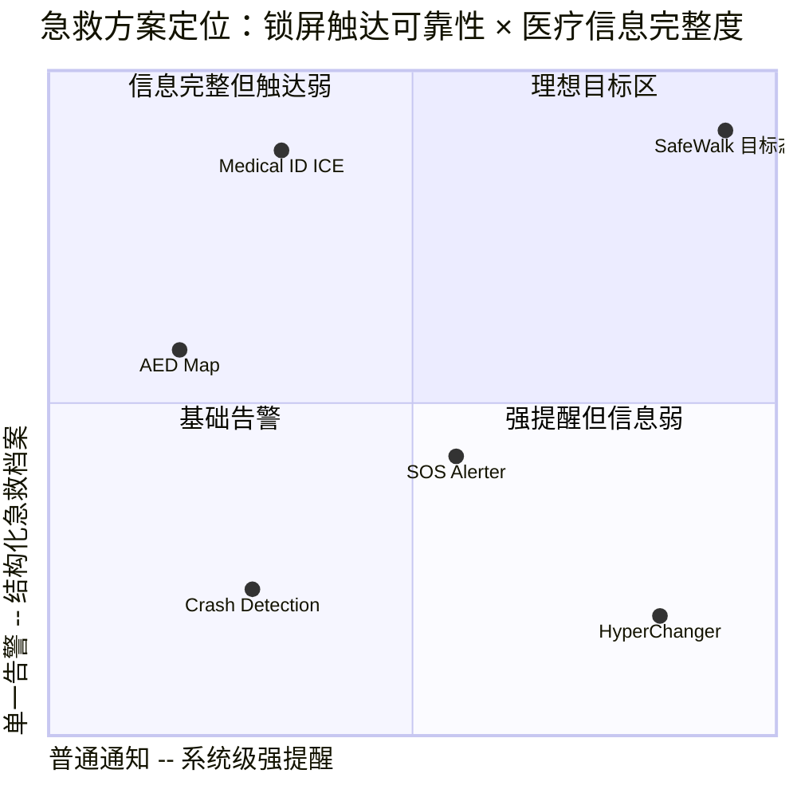
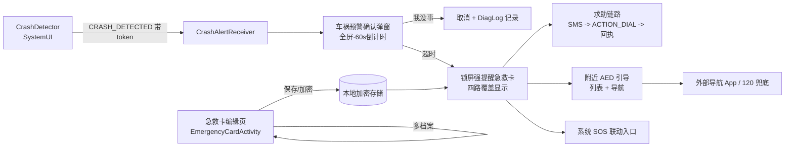

# SafeWalk「医疗急救卡功能」完整 PRD（开源方案调研 + 产品设计）

| 项 | 内容 |
|---|---|
| Language | 中文（简体） |
| Project Name | `safewalk_emergency_medical_card` |
| 基线仓库 | [Xposed-Modules-Repo/io.github.wumisc.safewalk](https://github.com/Xposed-Modules-Repo/io.github.wumisc.safewalk) |
| 技术栈 | Kotlin/Java 混合 · AGP 9.x · minSdk 33 / targetSdk 35 · Compose + Miuix · LSPosed 注入 SystemUI |
| 文档版本 | v1.0 · 完整 PRD（含开源方案调研） |
| 作者 | 许清楚（Xu）· 产品经理 |

### 原始需求复述

> 1. 车祸预警实际方案落成；2. 车祸发生锁屏强提醒信息，百分百显示信息；3. 系统 SOS 紧急功能联动方案；4. 急救卡做可选血型、可选住址等；5. 前往紧急呼救装置，引导不到位置。让人在最危险的第一时间，做足准备。

---

## 0. 现状盘点：已有雏形，扩展而非推倒重来

依据 [SafeWalk README](https://github.com/Xposed-Modules-Repo/io.github.wumisc.safewalk) 与 [`docs/LOGIC_DESIGN.md`](https://github.com/Xposed-Modules-Repo/io.github.wumisc.safewalk/blob/main/docs/LOGIC_DESIGN.md) 实际代码文档核对：

| 已有能力/文件 | 当前实现（已核实） | 本 PRD 的扩展方式 |
|---|---|---|
| `CrashDetector.kt`（SystemUI 进程） | 低通滤波 α=0.8 估重力；动态加速度 `|a-g|`；三档阈值 25/20/15 m/s²（≈2.5/2.0/1.5g）；连续 2 点命中；60s 冷却；`SENSOR_DELAY_UI`≈60ms；发 `CRASH_DETECTED` 带 token 广播 | **保留全部现有参数与冷却**，新增"速度变化 + 姿态 + 屏幕状态"融合判别，降低误报；不重写算法骨架 |
| `CrashAlertReceiver.java` | 接收带 token 的 `CRASH_DETECTED`，拉起全屏页 | 扩展携带急救卡摘要与求助命令，复用 `CONTROL` signature 权限 + token 双校验 |
| `EmergencyAlertActivity.java` | 全屏告警页 + 倒计时 + "我没事"误报兜底；红底整屏是主题契约唯一例外 | **直接在此页扩展字段渲染、QR、AED 入口**，不新建 Activity；补齐 `showWhenLocked`/`turnScreenOn` 与注入式覆盖层 |
| `EmergencyCardActivity` | 已存在，具体交互文档未展开 | 扩展血型/Rh/住址/过敏/用药/联系人等字段；沿用"不导出到 ConfigProvider"的隐私约束 |
| `EmergencyCommandSecurityTest` | 仓库中已有该类，但 `LOGIC_DESIGN.md` 未记录其覆盖范围 | 需架构师确认；PRD 建议扩展为"急救命令安全测试"（token、广播权限、fail-closed） |
| `ConfigProvider.kt` | `content://io.github.wumisc.safewalk.config/config`；白名单导出；uid fail-closed；急救卡姓名/血型/住址/电话**一律不导出** | 只新增功能开关键，继续**禁止**任何医疗隐私字段进入白名单 |
| `DiagLog.kt` | 双进程共享，400 行环形缓冲 + 512KB 文件轮转 | 新增"撞击/呈现成功/呈现失败/降级动作"结构化事件，作为 100% 验收证据链 |
| `SafeWalkLSPHook` | 四层启动入口并联；2s/5s tick 巡检；注入仅勾 `com.android.systemui` | 新增锁屏覆盖 View 注入与存在性巡检，复用既有 tick 与 `updateCrashDetection()` 模式 |

> 已知限制（README 自述）：车祸检测靠加速度阈值，手机脱落可能误报，留 60s 倒计时可取消；全屏叠加个别 ROM 可能被厂商悬浮窗策略拦截；通知 heads-up 可被 HyperOS 超级岛拦截；保活是"被杀后自动恢复"而非"永不被杀"。这些是本 PRD 必须正面处理的设计约束。

---

## 1. 产品目标

### 一句话价值主张

> **在车祸发生后的第一秒，把"我是谁、我怎么了、找谁、去哪急救"强制推到用户与施救者眼前，并自动完成求助闭环——让人在最危险的第一时间，做足准备。**

### 可量化目标

| # | 目标 | 指标（验收口径） |
|---|---|---|
| G1 | 检测快且准 | 模拟碰撞场景检出率 ≥ **95%**；日常活动（步行/骑行/手机跌落/放口袋）误报 ≤ **1 次 / 1000 小时** |
| G2 | 锁屏强提醒"百分百" | 在"SystemUI 存活 + 设备开机"前提下，亮屏/灭屏/锁屏/静音/勿扰/通知渠道关闭 6 类矩阵各 50 次，**可见率 100%**；触发到可见 **P95 ≤ 1.5s** |
| G3 | 信息一次看全 | 锁屏页在不解锁条件下可见 ≥6 项关键字段（血型、过敏、住址、紧急联系人、当前定位、AED 引导），关键字段字号 ≥18sp，红底高对比 |
| G4 | 求助不静默失败 | 倒计时超时后 100% 执行"短信 → 拨号盘预填 → 可见回执"链路；任一环节失败必须有 DiagLog + 屏幕可见提示 |
| G5 | 急救信息可补全 | 目标用户急救卡关键字段（血型/过敏/至少 1 位联系人）填写完成率 ≥ **80%** |
| G6 | 引导找得到装置 | 有 OSM AED 数据覆盖区域，500m 内急救装置引导可用率 ≥ **90%**；无数据时 100% 明确提示"暂无登记装置，请拨 120"，绝不空白 |

---

## 2. 用户故事（对应 5 个功能点）

| # | 功能点 | 用户故事 |
|---|---|---|
| US1 | 车祸预警落成 | 作为**独自驾车/步行通勤者**，我想要手机在剧烈撞击后**自动识别**并立即进入急救流程，以便我在失去意识或无法操作时也不会错过黄金救援时间。 |
| US2 | 锁屏强提醒 100% 显示 | 作为**车祸后可能昏迷的伤者或赶到现场的施救者**，我想要急救卡信息**无视锁屏、静音、勿扰直接铺满屏幕**，以便不需解锁、不需寻找 App 就能第一时间读到关键信息。 |
| US3 | 系统 SOS 联动 | 作为**尚清醒但无法顺畅操作屏幕的用户**，我想要一键联动系统紧急呼叫与系统医疗信息入口，以便用系统级通道求助，而不是依赖某个可能没打开的子功能。 |
| US4 | 急救卡可选字段 | 作为**有过敏史/特殊血型/慢病的用户**，我想要按需填写血型、Rh、住址、过敏史、用药、紧急联系人等字段，以便施救者拿到的是"针对我"的信息，而不是通用模板。 |
| US5 | 紧急呼救装置导航 | 作为**施救者或伤者同伴**，我想要快速看到最近的 AED/急救箱/报警按钮并得到步行引导，以便把"找设备"的时间压缩到最少；即使没网也有可用指引。 |

---

## 3. 开源 / 竞品方案调研（本次核心）

> 检索方式：WebSearch + WebFetch 实检 GitHub、AOSP/Android Developers 官方源，按 5 个功能点交叉验证。所有链接均为检索到的真实来源，未编造。

### 3.0 竞品定位象限



### 3.1 车祸 / 碰撞检测（基于加速度计 + 突变 + 速度变化）

| 项目 / 机制 | 链接 | 核心做法 | 可借鉴点 | 在 SafeWalk 的适配难点 |
|---|---|---|---|---|
| **Navaneeth832/Crash-Detection** | [github.com/Navaneeth832/Crash-Detection](https://github.com/Navaneeth832/Crash-Detection) | Kotlin + Compose；前台服务 `SENSOR_DELAY_GAME` 高频读加速度；合加速度 >5g 触发；10s 倒计时+声音，可"我安全"取消；超时发 SMS（含 Google Maps 位置链接）；按 G 值分 MINOR/SEVERE/EXTREME；WakeLock 保 CPU | 前台服务 + 倒计时取消 + **严重度分级** + 位置短信模板，与现有 `CrashDetector` + `EmergencyAlertActivity` 高度同构 | 依赖 GMS Location 与 SMS；本项目纯本地无 GMS；5g 阈值偏高，手机跌落/手持场景需结合姿态二次判别 |
| **Ayushmaan04/IoT_Crash-detection** | [github.com/Ayushmaan04/IoT_Crash-detection](https://github.com/Ayushmaan04/IoT_Crash-detection) | TFLite 端侧模型，输入 accel/gyro 六轴 + magnitude + `motion_energy`（滚动窗口）；用 **MobiFall 数据集**另训跌倒分类器区分"摔手机"；CARLA 仿真生成碰撞数据；30s 蜂鸣倒计时 | **双阶段判别（碰撞 + 跌倒排除）是压低误报的关键**；滚动窗口能量特征可补现有"2 连续采样"的单一判据 | TFLite 推理放 SystemUI 不合适；建议 SystemUI 只做粗筛，App 进程做二次判别；增加包体与算力 |
| **liangxyz/CarRecoder** | [github.com/liangxyz/CarRecoder](https://github.com/liangxyz/CarRecoder) | 开源行车记录仪；G-Sensor 碰撞检测自动**加锁前后视频片段**防覆盖；GPS 水印车速；本地优先无云 | "撞击瞬间锁存关键证据"思路 → 可映射为撞击时锁存最近 N 秒传感器波形 + DiagLog 现场 | 需相机/录像权限，与行走模式仅"画面叠加"不同；仅借鉴事件锁存，不引入录像 |
| **8harath/Car_Crash_Detection** | [github.com/8harath/Car_Crash_Detection](https://github.com/8harath/Car_Crash_Detection) | ESP32+MPU6050+GPS 经 BLE 送 Android；碰撞分级 LOW/MEDIUM/HIGH/CRITICAL；附带医疗档案（血型/过敏/用药/器官捐献）；MQTT QoS1 广播给救援端，含**确认回执 + ETA**；离线队列重试 | "碰撞事件 + 医疗档案 + 确认回执"完整闭环；医疗档案字段可直接参考 | 依赖外部硬件与 MQTT broker，不符纯本地约束；仅借鉴闭环与字段 |
| **andyliukun/Crash-Alert** | [github.com/andyliukun/Crash-Alert](https://github.com/andyliukun/Crash-Alert) | 加速度计检测碰撞，短信附带位置与**附近医院号码** | 把"就近救援资源"随警报一并下发 | 医院数据源需联网；离线需本地 POI（见 3.5） |

**误报率控制结论**：现有"低通 α=0.8 + 2 连续采样 + 60s 冷却 + 三档阈值"是合格基线；要达到 G1（≤1/1000h）需再叠加三层：①速度突变（位置窗口 Δv，由 App 进程提供）；②姿态判定（复用已有 UPRIGHT/LAY_FLAT/TILTED，撞后 LAY_FLAT/TILTED 加权）；③"非跌倒"排除（借鉴 MobiFall 思路，先做规则版，TFLite 列 P2）。

### 3.2 锁屏强提醒 100% 显示

| 项目 / 机制 | 链接 | 核心做法 | 可借鉴点 | 在 SafeWalk 的适配难点 |
|---|---|---|---|---|
| **rahul-lohra/AndroidLockScreenNotification** | [github.com/rahul-lohra/AndroidLockScreenNotification](https://github.com/rahul-lohra/AndroidLockScreenNotification) | `NotificationCompat.Builder.setFullScreenIntent(pi, true)` + `USE_FULL_SCREEN_INTENT` + `IMPORTANCE_HIGH` 渠道；Activity 设 `showWhenLocked`/`turnScreenOn`；5s 延时演示锁屏触发 | 合规 FSI 双 flag 组合，作为**标准路径基线** | Android 14+ FSI 权限仅通话/闹钟类；OEM（小米/三星）需额外锁屏权限 → 不能作为唯一通道 |
| **doanpt/PhoneActivity** | [github.com/doanpt/PhoneActivity](https://github.com/doanpt/PhoneActivity/blob/main/README.md) | 前台服务发高优先级 FSI 通知；`onStartCommand` 发 `ACTION_CLOSE_SYSTEM_DIALOGS` 广播"踢"开全屏 Intent；Window 加 `FLAG_SHOW_WHEN_LOCKED`/`FLAG_DISMISS_KEYGUARD`/`FLAG_TURN_SCREEN_ON` | `ACTION_CLOSE_SYSTEM_DIALOGS` 是让 FSI 真正弹出的关键 trick，纳入兜底链路 | 仍受 FSI 权限限制；**`FLAG_DISMISS_KEYGUARD` 在有安全锁屏时无效**，不能替用户解锁（也不应尝试） |
| **AOSP Full-screen intent limits** | [source.android.com/docs/core/permissions/fsi-limits](https://source.android.com/docs/core/permissions/fsi-limits)、[Android 14 行为变更](https://developer.android.com/about/versions/14/behavior-changes-14) | Android 14+ 默认 FSI 仅授予通话/闹钟类应用；`NotificationManager.canUseFullScreenIntent()` 检测；`ACTION_MANAGE_APP_USE_FULL_SCREEN_INTENT` 引导；被拒时降级 60s heads-up | **官方明确"100%"的边界**：用户/商店可撤销 FSI；被拒时必须有可见 HUN 降级，不能静默 | 非 Play 分发仍可能被 OEM 拒绝；这正是必须走 **Xposed 注入 SystemUI 直接加 View** 的理由 |
| **ColdP/HyperChanger** | [github.com/ColdP/HyperChanger](https://github.com/ColdP/HyperChanger/blob/main/README_en.md) | LSPosed 注入 SystemUI/锁屏，深度定制锁屏时钟、小组件、胶囊，锁屏胶囊集成高德导航；多 Hook 锚点 + 版本适配 | 证明 **Xposed hook SystemUI 锁屏自定义 View 成熟可行**；多 ROM 锚点适配经验 | 面向 HyperOS4/Android17；本项目 minSdk33/target35 多 ROM，锁屏 View 锚点因 ROM 而异 → 需 WindowManager 全局注入作为兜底 |
| **Android 通知可见性机制** | [developer.android.com 通知文档](https://developer.android.com/develop/ui/views/notifications/create-notification) | `VISIBILITY_PUBLIC/PRIVATE/SECRET` 决定锁屏显示程度；用户始终可控制渠道是否显示在锁屏 | 急救卡通知必须 `VISIBILITY_PUBLIC` | 用户可关锁屏通知/渠道 → 只能做辅助通道，不能承担 100% |
| **sekin.in 机制综述** | [How to Create an Android Lock Screen Application](https://sekin.in/how-to-create-an-android-lock-screen-application-what-is-and-isnt-possible) | 普通 App 无法替换安全锁屏；可用 `showWhenLocked`/`turnScreenOn` 临时显示在 keyguard 之上；专用设备才可用 DPC/Lock Task 禁用 keyguard | 明确技术边界：目标是"覆盖显示"而非"解锁"，避免产品承诺越界 | 同左，作为风险章节依据 |

**"100% 显示"的可达定义（产品口径）**：在 **设备开机且 SystemUI 进程存活** 的前提下，通过 ①Xposed 注入 SystemUI 直接向 WindowManager 添加 `TYPE_APPLICATION_OVERLAY`/锁屏层高优先级 View（不经过通知渠道，绕过超级岛拦截）+ ②全屏 Activity `showWhenLocked`/`turnScreenOn` + ③FSI 通知标准路径 + ④`ACTION_CLOSE_SYSTEM_DIALOGS` 兜底，四路并用达成 100% 可见；**不可达边界**（关机、电量耗尽、SystemUI 崩溃且框架未加载、用户强制停止并关闭自启）必须显式降级为短信/电话回执，不得承诺。

### 3.3 系统 SOS 紧急功能联动

| 项目 / 机制 | 链接 | 核心做法 | 可借鉴点 | 在 SafeWalk 的适配难点 |
|---|---|---|---|---|
| **AOSP Emergency Affordance** | [source.android.com/docs/core/connect/emergency-affordance](https://source.android.com/docs/core/connect/emergency-affordance) | `EmergencyAffordanceManager.performEmergencyCall()`；锁屏 EMERGENCY 按钮 + 长按电源键全局操作菜单；`EmergencyAffordanceService` 按 MCC(404/405) 启用；`config_emergency_call_number`=112 | 系统级 SOS 的真实入口与"一键紧急呼叫"语义；作为联动目标 | **无公开 SDK API**，仅系统应用/签名权限可用；本项目只能拉起系统紧急拨号盘或经 Xposed hook 内部 API（高风险，需白名单ROM验证） |
| **yogendhra9/womensafetyapp** | [github.com/yogendhra9/womensafetyapp](https://github.com/yogendhra9/womensafetyapp) | `PowerButtonService` 前台服务监听 `SCREEN_OFF`，3s 内按电源键 5 次静默触发 SOS；BroadcastReceiver 跨进程；BOOT 自启 | 硬件键序列检测可作为"车祸后二次确认/主动求救"冗余触发 | Android 14+ 后台收 `SCREEN_OFF` 受限；本项目已在 SystemUI，监听 Keyguard/PhoneWindowManager 更稳 |
| **dhilipmpms/SOS-alerter** | [github.com/dhilipmpms/SOS-alerter](https://github.com/dhilipmpms/SOS-alerter) | 电源键三击 / 音量键快按 / 摇动（加速度计）多触发器；`CALL_PHONE` 直拨；短信+位置+Live Tracking；静音模式 | **多触发器互为冗余**，覆盖"有意识但无法操作屏幕"；字段与动作模板可参考 | `CALL_PHONE` 静默代拨有误拨责任风险，本项目改为 `ACTION_DIAL` 预填，用户一键确认 |
| **系统公开 Intent（联动优先路径）** | [Android Intent 文档](https://developer.android.com/reference/android/content/Intent)、[系统设置紧急信息入口实践](https://github.com/bloodf/vezuna/issues/102) | `Intent.ACTION_DIAL` + `tel:` 预填紧急号码；系统"紧急信息/医疗 ID"设置入口（如 `EDIT_EMERGENCY_INFO`，各 ROM 名称不一） | 优先用公开 Intent 联动系统，而非 hook 私有 API；`resolveActivity` 逐条校验 | ROM 差异大，必须候选链 + 应用详情页兜底（复用现有 ROM 指路表机制） |

### 3.4 急救卡字段设计（血型 / 住址 / 过敏 / 联系人）

| 项目 / 机制 | 链接 | 核心做法 | 可借鉴点 | 在 SafeWalk 的适配难点 |
|---|---|---|---|---|
| **Medical ID - ICE Contacts** | [AndroidBlip 产品页](https://www.androidblip.com/android-apps/app.medicalid.html) | 锁屏可访问的医疗档案：过敏、血型、医疗联系人；一键 SMS（含位置）；锁屏直接呼叫；多档案（家人）；BMI；当前地址/GPS；指南针 | **字段全集 + 多档案 + 锁屏直达**；用户差评"锁屏入口会消失"反向印证强提醒必要性 | 闭源付费；本项目需自研字段存储与锁屏渲染 |
| **akineni/telemergency** | [github.com/akineni/telemergency](https://github.com/akineni/telemergency) | 档案字段：name/gender/age/**blood group/genotype/allergies/medical conditions**；一键构造含 bio-data + 位置的 SMS 发医疗单位 | 结构化字段 + SMS 文本模板可直接映射 | Firebase 依赖不符本地优先，仅取字段设计 |
| **karthikeyankc/emergency-medical-card** | [github.com/karthikeyankc/emergency-medical-card](https://github.com/karthikeyankc/emergency-medical-card) | 表单生成钱包卡/PDF/锁屏 PNG 壁纸；**117 国紧急号码表，每条带来源与核对日期**；DO / DO NOT 建议字段；"10 秒可读"信息密度原则 | 字段命名、多语言、紧急号码可追溯；"10 秒可读"作为版式验收标准 | 网页工具需移植为 Compose 表单；紧急号码表可离线内置 |
| **rupumped/EQR** | [github.com/rupumped/EQR](https://github.com/rupumped/EQR) | 把医疗信息编码进 QR，印卡片/设为锁屏，施救者扫码即读，**无需 App、无服务器** | 锁屏急救卡附 QR，作为"无 App 依赖"的分享兜底 | QR 为明文，需在 UI 提示隐私权衡；不联网符合本项目原则 |
| **Khushi-50/MediQuick** | [github.com/Khushi-50/MediQuick](https://github.com/Khushi-50/MediQuick) | Flutter 生成含医疗 QR 的锁屏壁纸；血型/过敏/ICE 联系人；本地保存 | 锁屏壁纸兜底方案（无 Xposed 权限时） | 壁纸非强提醒，仅 P2 兜底 |
| **cristianaprecup/Emergency-Android-App** | [github.com/cristianaprecup/Emergency-Android-App](https://github.com/cristianaprecup/Emergency-Android-App) | 用户档案存过敏/病症/用药；紧急 SMS + 呼叫 + Google Maps 导航附近医院/警局 | 字段与"导航"结合的完整流程 | Google Maps 依赖 GMS，需换 OSM/外部导航 Intent |

**字段设计结论（本项目采纳）**：姓名 / 年龄 / 血型（A/B/AB/O/其他/未知）+ Rh（±/未知）/ 过敏史（文本 + 严重标记）/ 基础疾病 / 当前用药 / 常住住址 / 紧急联系人（≥3，含关系）/ 医保或身份证号（可选，默认关）/ 器官捐献意愿（可选）/ 一键生成的医疗 QR。全部本地加密存储，**继续禁止进入 ConfigProvider 白名单**（现有隐私约束）。

### 3.5 紧急呼救装置导航（AED / 急救箱 / 报警按钮）

| 项目 / 机制 | 链接 | 核心做法 | 可借鉴点 | 在 SafeWalk 的适配难点 |
|---|---|---|---|---|
| **matisiekpl/aed_map** | [github.com/matisiekpl/aed_map](https://github.com/matisiekpl/aed_map) | Flutter；数据来自 **OSM**；**Valhalla 步行导航引擎**；TileServer-gl 矢量渲染；显示 AED 位置/可达性/开放时间/电话；社区可增改 POI | 最贴近需求：AED 字段（access / opening_hours / phone）+ 步行导航；OSM 数据可离线 | Flutter/Dart 不便直接复用；本项目宜 Overpass 预取 + 本地列表/距离 + 外部导航 Intent |
| **Organic Maps** | [github.com/organicmaps/organicmaps](https://github.com/organicmaps/organicmaps) | 基于 OSM 的离线地图 + 步行/驾车 turn-by-turn；无广告无追踪；支持 GPX/KML/GeoJSON 书签导入导出 | 离线 POI + 导航能力；作为"跳转导航"目标 App | 体积大不内嵌；需处理未安装兜底（跳系统地图或纯文字方位指引） |
| **OsmAnd** | [github.com/osmandapp/OsmAnd](https://github.com/osmandapp/OsmAnd) | OSM 离线地图，步行/骑行/驾车语音导航，按类型/坐标搜索 POI，插件体系 | 老牌离线导航，可作为备选跳转目标 | 授权为 other，注意合规；同样不内嵌 |
| **OpenStreetMap / Overpass API** | [openstreetmap-website](https://github.com/openstreetmap/openstreetmap-website)、[Overpass API](https://overpass-api.de) | 全球协作 POI 库；Overpass 可按 `amenity=defibrillator` 等标签查询附近 AED | 数据源与查询语法直接可用；可预生成离线 POI 包 | **国内 AED 在 OSM 覆盖率低** → 必须有用户自建 POI（GeoJSON 导入导出）与"无数据请拨 120"兜底 |

---

## 4. 需求池（P0 / P1 / P2，含验收标准）

### P0 — Must have（必须做，缺一则本次交付不成立）

| ID | 需求 | 验收标准 |
|---|---|---|
| P0-1 | **碰撞检测升级**：复用 `CrashDetector`，保留 α=0.8 低通、2 连续采样、60s 冷却、三档 1.5/2.0/2.5g；新增速度变化（App 进程位置窗口 Δv）、姿态（LAY_FLAT/TILTED 加权）、屏幕状态融合；"我没事"取消沿用 | 模拟碰撞检出率 ≥95%；1000h 日常活动误报 ≤1；单测覆盖"跌落/放口袋/急刹车不触发"≥3 个用例；现有 `CrashDetectorTest` 不回归 |
| P0-2 | **锁屏强提醒四路并用**：①SystemUI 注入高优先级覆盖 View（不依赖通知渠道）②全屏 Activity `showWhenLocked`/`turnScreenOn` ③FSI 通知 ④`ACTION_CLOSE_SYSTEM_DIALOGS` 兜底；复用现有 tick 巡检覆盖层存在性 | 6 类状态矩阵（亮屏/灭屏/锁屏/静音/勿扰/通知渠道关闭）各 50 次，可见率 **100%**，P95 ≤1.5s；任一路径失败写 DiagLog 并触发短信降级 |
| P0-3 | **急救卡信息必显**：在 `EmergencyAlertActivity` 扩展渲染血型/Rh、过敏、住址、≥1 紧急联系人、当前定位、AED 引导；红底高对比，关键字段 ≥18sp，不解锁可读 | 截图 OCR 可正确识别 ≥6 项关键字段；主题契约例外（整屏红）不回归 |
| P0-4 | **倒计时与误报取消**：沿用 60s 倒计时 + "我没事"按钮；超时进入求助链路 | 倒计时内取消 100% 不发求助；超时 100% 进入 P0-5；取消事件写 DiagLog 供误报统计 |
| P0-5 | **求助闭环**：超时后先发 SMS（位置链接 + 急救卡摘要），再拉起 `ACTION_DIAL` 预填紧急联系人/120（**不静默代拨**）；无权限时跳转权限页 + 可见回执，不静默失败 | 权限齐全时 SMS 本机发送回执成功率 ≥99%；权限缺失时 100% 有屏幕提示 + DiagLog；无"点了没反应"路径 |
| P0-6 | **急救卡字段扩展与加密存储**：扩展 `EmergencyCardActivity`，采纳 3.4 字段结论，本地加密存储；沿用"不导出 ConfigProvider"约束 | 字段可增改查；`grep` ConfigProvider 导出的 JSON **找不到任何姓名/血型/住址/电话**；`EmergencyCommandSecurityTest` 扩展覆盖该断言 |
| P0-7 | **隐私与权限最小化**：不联网、不上传；`SEND_SMS`/`CALL_PHONE`/定位按需申请；FSI 不可用时 `canUseFullScreenIntent()` 检测并引导 | 抓包 0 外发；权限拒绝路径 100% 有降级；`ConfigProvider` fail-closed（uid 判据）不回归 |

### P1 — Should have（应该做）

| ID | 需求 | 验收标准 |
|---|---|---|
| P1-1 | **系统 SOS 联动**：一键拉起系统紧急拨号盘 / 系统紧急信息设置页；候选 Intent 逐条 `resolveActivity` 校验，全失败退应用详情页 | 6 款目标 ROM 中每款至少 1 个候选可打开；无 ActivityNotFound 崩溃 |
| P1-2 | **AED/急救装置导航**：Overpass 预取 3km 内 AED，本地列表 + 直线距离/预计步行时间 + 跳转外部离线地图导航；无数据时明确提示拨 120 | 有数据区域 500m 内引导可用率 ≥90%；无数据提示覆盖率 100%；无网时本地列表仍可用 |
| P1-3 | **用户自建 POI**：手动添加急救装置位置，GeoJSON 导入/导出 | 添加后立即可导航；导入导出数据往返一致 |
| P1-4 | **电源键序列触发**：3s 内 3~5 次电源键触发 SOS（借鉴 womensafetyapp），在 SystemUI 侧监听而非后台 Receiver | 模拟序列触发成功率 ≥95%；不因后台限制失效 |
| P1-5 | **多档案**：本人/家人急救卡切换 | 切换后锁屏页展示对应档案；数据隔离不串档 |
| P1-6 | **锁屏医疗 QR**：急救卡页展示 QR（本地生成，明文风险有 UI 提示） | 标准相机可扫码读出关键字段；不联网 |
| P1-7 | **误报自适应**：用 DiagLog 取消事件微调阈值（仅记录与建议，不自动改动用户档位） | 误报事件可导出统计；用户可一键采纳建议档位 |

### P2 — Nice to have（可做）

| ID | 需求 | 验收标准 |
|---|---|---|
| P2-1 | TFLite 双阶段判别（App 进程二次判别，借鉴 IoT_Crash-detection） | 相对 P0-1 误报再降 ≥30%，且 P95 延迟增加 ≤200ms |
| P2-2 | 撞击现场锁存：最近 10s 传感器波形 + 1 帧缩略图写入 DiagLog（隐私开关默认关） | 开关开启方可锁存；文件加密；可一键清除 |
| P2-3 | 离线 AED 数据包下载/更新 | 包体 ≤20MB；可校验完整性 |
| P2-4 | 无障碍语音播报急救卡（TalkBack / TTS） | 关键字段可朗读；TalkBack 焦点顺序正确 |
| P2-5 | 锁屏壁纸兜底（无 Xposed 权限时生成含 QR 的壁纸，借鉴 MediQuick） | 无 root 环境仍可生成并展示 |

---

## 5. UI 设计稿

### 5.1 界面流转



### 5.2 关键界面一：急救卡编辑页

文字线框（Compose + Miuix，卡片 + 行列表版式，沿用现有视觉 token）：

```
┌─────────────────────────────────┐
│ ← 医疗急救卡        [本人 ▾]  [保存] │
├─────────────────────────────────┤
│ 基本信息                         │
│  姓名        [____________]      │
│  年龄        [__]  性别 [男/女/其他]│
│  血型   [A ▾]  Rh [+ ▾]  ← 可选 │
│  常住住址   [________________]   │  ← 可选，默认折叠
├─────────────────────────────────┤
│ 医疗信息（施救者优先看）           │
│  过敏史  [________________] ⚠严重 │
│  基础疾病 [________________]      │
│  当前用药 [________________]      │
│  器官捐献 [关 ▾]                 │
├─────────────────────────────────┤
│ 紧急联系人（至少 1 位）            │
│  ① [姓名] [关系] [电话]          │
│  ② + 添加                       │
├─────────────────────────────────┤
│ 隐私与分享                       │
│  锁屏展示全文  [开]              │
│  医疗 QR 码    [生成] ⚠明文提示  │
│  仅本地存储·不联网·不上传          │
└─────────────────────────────────┘
```

### 5.3 关键界面二：车祸预警确认弹窗（全屏）

```
┌─────────────────────────────────┐
│ ⚠ 检测到剧烈撞击                │  ← 整屏红底，主题契约例外
│                                 │
│   怀疑发生车祸                   │
│   撞击强度：SEVERE (2.3g)         │
│   时间：14:32  定位：已获取        │
│                                 │
│      ┌───────────────┐          │
│      │  60  秒后自动求助 │          │  ← 大号倒计时
│      └───────────────┘          │
│                                 │
│  [ 我没事 · 取消求助 ]            │  ← 误报兜底，点击即取消
│                                 │
│ 60 秒内未确认 → 发送位置短信 +     │
│ 拉起紧急拨号盘（需你按拨号键）      │
└─────────────────────────────────┘
```

### 5.4 关键界面三：锁屏强提醒急救卡（100% 显示目标态）

```
┌─────────────────────────────────┐
│ 🚨 医疗急救卡  · 无需解锁         │  ← 覆盖锁屏，红色高对比
├─────────────────────────────────┤
│ 姓名 张三  38岁   血型 A+ ⚠      │  ← ≥18sp
│ 过敏 青霉素（严重）               │
│ 疾病 哮喘   用药 沙丁胺醇          │
│ 住址 北京市朝阳区……               │
│ 联系 李四（配偶）138****0000      │
│ 定位 已获取 · 14:32 更新           │
├─────────────────────────────────┤
│ [📞 紧急呼叫 120] [📍 附近 AED]   │
│ [🖨 医疗 QR]      [系统 SOS]      │
├─────────────────────────────────┤
│ 求助将在 60s 后自动进行 · 点此取消 │
└─────────────────────────────────┘
```

---

## 6. 关键风险与待确认问题

### 6.1 "百分百显示"的技术边界（最高优先级）

| 风险 | 说明 | 产品处置 |
|---|---|---|
| 官方 FSI 权限不可依赖 | Android 14+ 仅通话/闹钟类默认授予，用户可撤销（AOSP 已确认） | 四路并用，主路径为 Xposed 注入 View，不经过通知渠道 |
| 安全锁屏不可解除 | `FLAG_DISMISS_KEYGUARD` 在有密码/生物锁时无效；普通 App 不能替换系统验证器 | 产品目标定义为"覆盖显示"而非"解锁"；不诱导用户输入锁屏密码 |
| OEM 拦截 | HyperOS 超级岛可拦 heads-up；厂商悬浮窗策略可拦 overlay | 主路径注入 SystemUI 视图层；失败写 DiagLog 并短信降级 |
| 不可达场景 | 关机、没电、SystemUI 崩溃且框架未加载、用户强制停止且关自启 | **对外不承诺这些场景**；文档与 UI 明示前提；用短信/电话回执兜底 |

> **待确认 Q1**：是否接受"设备开机 + SystemUI 存活"作为"100%"的显式前提？若要求绝对 100%（含关机），技术上不可实现，需降级为"外部救援服务"命题。

### 6.2 误报处理

| 风险 | 说明 | 处置 |
|---|---|---|
| 手机跌落 vs 车祸 | 现有阈值 1.5g 档位下跌落可能误报（README 已承认） | 三层融合判别 + 60s 取消；默认档位维持 1（2.0g），不默认开到最灵敏 |
| 误拨 120 的社会成本 | `CALL_PHONE` 静默代拨可能造成无效警情 | 一律 `ACTION_DIAL` 预填，用户按拨号键；不静默代拨 |
| 默认开关 | 现有 `enableCrashDetection` 默认 **false** | **待确认 Q2**：本次是否改为默认开？建议保持默认关 + 首启引导开启，兼顾合规与用户信任 |

### 6.3 隐私合规

- 血型、住址、过敏史、病史属敏感个人信息；必须本地加密、不联网、不进 ConfigProvider 白名单（现有约束已正确，继续强化）。
- 锁屏展示全文与路人可见性冲突：提供"锁屏展示全文"开关，默认开（急救优先），UI 明示权衡。
- 医疗 QR 为明文：P1-6 加显著提示；P2 可评估非对称加密 + 救援方扫码 App（超出本期）。
- **待确认 Q3**：是否需要对接系统自带"紧急信息/医疗 ID"（`EDIT_EMERGENCY_INFO`）而非自建存储？建议 P1 做"跳转联动"，不替代本地存储。

### 6.4 权限与平台限制

| 权限/限制 | 风险 | 处置 |
|---|---|---|
| `USE_FULL_SCREEN_INTENT` | Android 14+ 受限，用户可撤销 | `canUseFullScreenIntent()` 检测 + 设置页引导 + 注入主路径 |
| `SEND_SMS` / `CALL_PHONE` | 运行时权限，OEM 可能默认拒绝 | 首启分步引导；拒绝时可见回执 + DiagLog；不静默失败 |
| 后台启动 Activity | Android 14+ 限制 | 复用现有透明中转页 + SystemUI Hook 触发（已有先例） |
| 前台服务类型 | camera 类型后台启动受限 | 复用现有三档降级与心跳看门狗 |

### 6.5 数据覆盖与稳定性

- AED 在国内 OSM 覆盖稀疏 → 用户自建 POI + 无数据明确兜底（G6）。
- 锁屏 View 锚点随 ROM/版本变化 → WindowManager 全局注入兜底 + 2s tick 巡检（复用现有机制）。
- **待确认 Q4**：`EmergencyCommandSecurityTest` 的实际覆盖范围未在 `LOGIC_DESIGN.md` 记录，请架构师确认后扩展为急救命令安全测试（token 校验、signature 权限、ConfigProvider fail-closed、隐私字段不导出断言）。

### 6.6 待确认问题汇总

| # | 问题 | 责任方 | 建议默认 |
|---|---|---|---|
| Q1 | "100%"是否接受"开机 + SystemUI 存活"前提 | 产品/用户 | 接受，书面明示边界 |
| Q2 | 车祸检测是否默认开启 | 产品 | 默认关 + 首启引导 |
| Q3 | 是否跳转系统医疗信息而非自建 | 产品/架构 | P1 做跳转联动，不替代本地 |
| Q4 | `EmergencyCommandSecurityTest` 覆盖范围确认与扩展 | 架构师 | 扩展为命令安全测试 |
| Q5 | 紧急号码是否内置 117 国表（借鉴 emergency-medical-card） | 产品 | 内置中国 120/110 + 可编辑，多国列 P2 |
| Q6 | AED 数据源是否允许引入商业/众包数据 | 产品/法务 | 本期仅 OSM + 用户自建 |

---

## 7. 交付口径（给架构师的实施边界）

1. **不改算法骨架**：`CrashDetector` 只做融合增强，现有阈值/冷却/广播协议保留。
2. **不新建急救 Activity**：`EmergencyAlertActivity` 直接扩展，`EmergencyCardActivity` 直接扩展。
3. **不引入 GMS / 云服务**：位置用系统 LocationManager；导航用 OSM 数据 + 外部 Intent；助手闭环用 SMS + ACTION_DIAL。
4. **不破坏隐私契约**：ConfigProvider 白名单永不加入医疗字段；DiagLog 中敏感字段脱敏。
5. **不承诺绝对 100%**：以四路覆盖 + 显式降级 + DiagLog 证据链达成可验收的"可达范围内 100%"。
